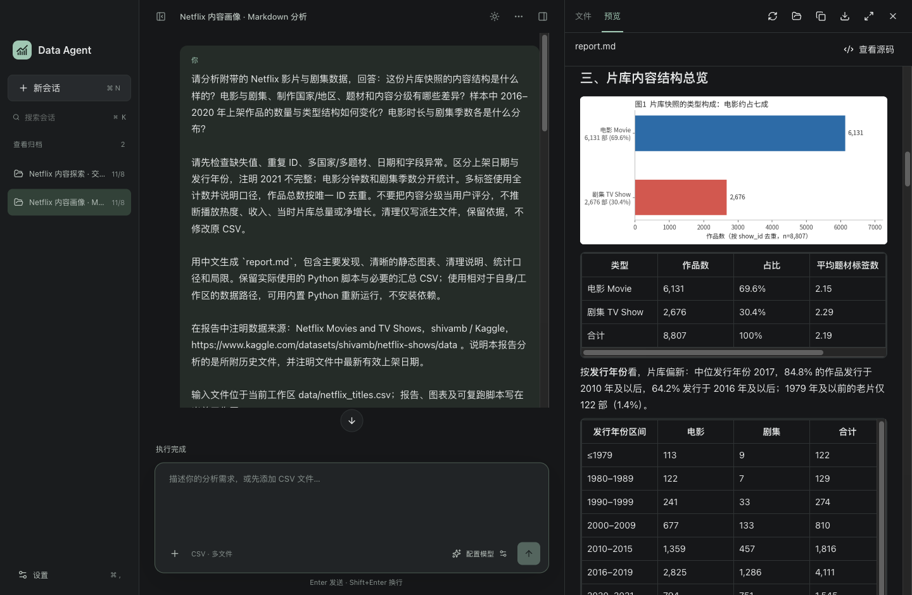

# Data Agent

用自然语言分析本地 CSV，生成图表、Markdown 报告和交互式 HTML 报告的 AI 工作台。支持 DeepSeek 和 OpenRouter，使用自己的 API key。



## 安装与使用

支持 macOS（Apple Silicon）。目前可从源码构建，步骤见下文。打开生成的 DMG，将 `Data Agent.app` 拖入“应用程序”即可，使用时无需安装 Node.js、Python 或分析库。

首次打开即可预览两个由 DeepSeek Flash 实际生成的 Netflix 分析示例：一份 Markdown 报告和一份可筛选的交互式 HTML 报告，无需配置 AI。数据、分析脚本和对话历史随应用提供；示例可继续对话、重命名或删除。数据来自 [Shivam Bansal 的 Kaggle 数据集](https://www.kaggle.com/datasets/shivamb/netflix-shows/data)。

开始自己的分析时，在设置中连接模型，添加 CSV 并描述分析目标。可以查看执行过程、继续提问，也可以用 steer 调整正在执行的任务、用 followup 排队提出后续请求。生成的文件保存在本地工作区。

## 开发

需要 macOS Apple Silicon、Node.js 22.22+、pnpm 10.14.0 和 uv。克隆仓库后运行：

```sh
pnpm install --frozen-lockfile
pnpm native:rebuild
pnpm runtime:prepare -- --download
pnpm dev
```

前两步安装依赖并为 Electron 编译 SQLite 模块；`runtime:prepare` 首次下载并校验内置 Python、分析库和工具。

| 命令               | 用途                                   |
| ------------------ | -------------------------------------- |
| `pnpm quality`     | 格式、Lint、类型、架构和文档链接检查   |
| `pnpm test`        | 普通回归测试，不调用真实模型           |
| `pnpm package:dmg` | 构建 macOS 安装镜像，输出实际 DMG 路径 |

开发和打包使用独立产物目录，不覆盖已安装的应用。更多测试与发布验收说明见 [测试指南](docs/testing-guide.md)。

## 项目架构

基于 Electron、TypeScript 和 React，使用 pi SDK 驱动 Agent。

| 模块                          | 职责                                                     |
| ----------------------------- | -------------------------------------------------------- |
| `src/renderer`、`src/preload` | 界面与受控 IPC 桥接                                      |
| `src/main`                    | 会话、SQLite、凭证、任务排队、工具执行与审批、工作区文件 |
| `src/agent`                   | 独立进程中的 pi 会话、模型交互与原生 JSONL 历史          |
| `src/shared`、`src/node`      | 跨进程契约与 Node 侧公共能力                             |
| `resources`                   | 内置 skills、示例会话、运行时版本与许可配置              |

Python 和常用分析库随应用打包；HTML 报告在隔离查看器中运行。会话元数据存入 SQLite，对话保留 pi 原生历史，报告和脚本保存为普通文件。

详细说明见 [使用指南](docs/usage.md)、[技术设计](docs/technical-design.md) 和 [文档索引](docs/README.md)。
