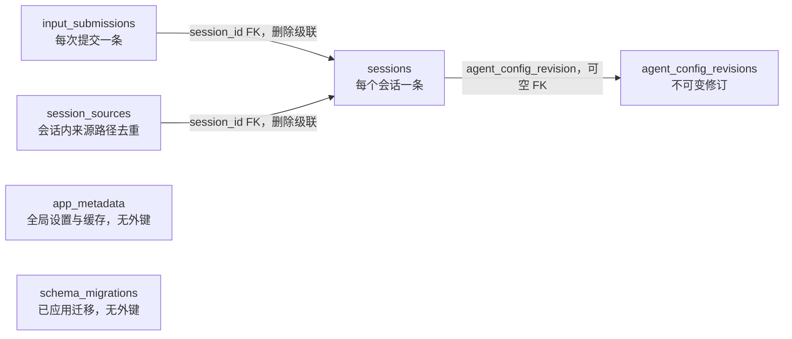
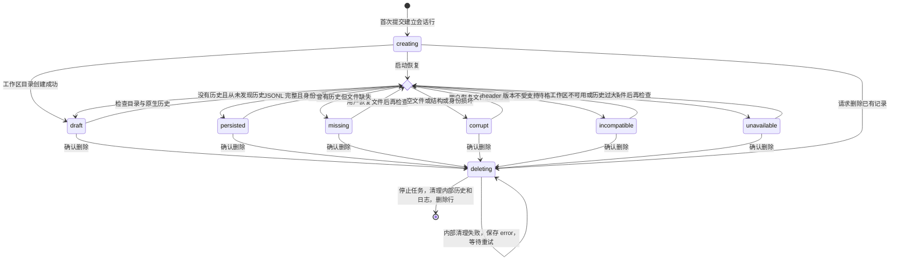
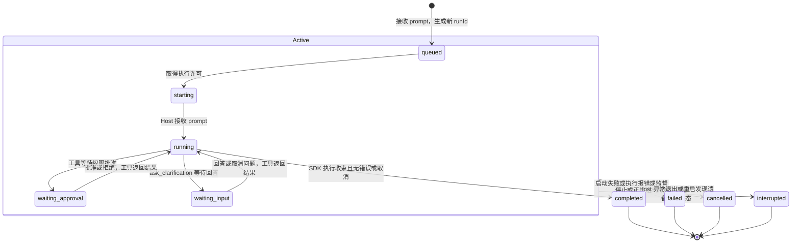
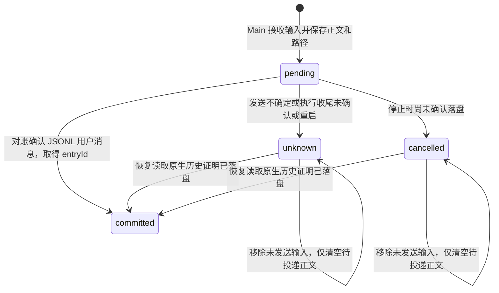
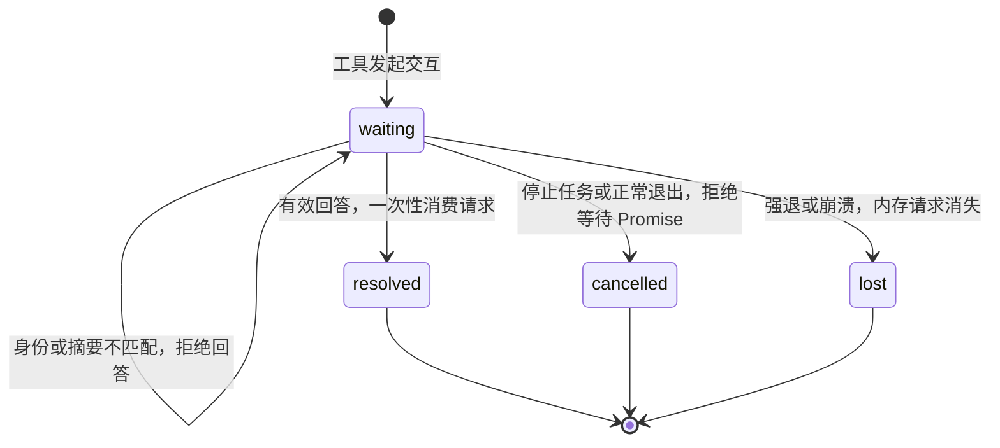

# SQLite 表设计与状态机

本文描述当前实现，更新于 2026-11-07，数据库 schema 版本为 **12**。架构入口见 [技术设计](technical-design.md)。字段已与迁移源码及隔离测试库的 `sqlite_master` 核对，不是下一阶段计划。

## 1. 数据边界与身份

默认数据库为 `~/.data_agent/state.sqlite`，Main 负责写入，使用 WAL、外键检查和 5 秒 busy timeout。共有 **6 张应用表**；SQLite 自动维护的 `sqlite_sequence` 不算业务表。

| 数据                                                   | 存放位置与职责                                                                                      |
| ------------------------------------------------------ | --------------------------------------------------------------------------------------------------- |
| 会话目录、可用性、最近执行状态、配置绑定、输入投递记录 | SQLite                                                                                              |
| 消息、工具调用与结果、系统上下文、用量、输入落盘身份   | `sessions/{sessionId}.jsonl`，pi 原生 session tree                                                  |
| 脚本、报告、图表等实际文件                             | `workspace/{sessionId}/`，同会话所有 run 共用                                                       |
| bash 超过 2 KiB 后保存的有界输出日志                   | `logs/{sessionId}/{sha256(toolCallId)}/{runId}.log`，Agent 经受控 read 读取，同 run 合计最多 10 MiB |
| 正在等待回答的审批/澄清、活动任务、FIFO 队列、事件 seq | 进程内存；退出不恢复执行                                                                            |

三种身份不能混用：

- **sessionId**：工作台会话身份，跨多轮保留；不同于 pi JSONL header 的 `pi_session_id`。首次提交创建会话时，当前入口使用第一条输入的 inputId 作为 sessionId。
- **runId**：一次持续执行的身份。空闲会话接收新 prompt 时生成；期间 steer/follow-up 共用 runId。终态后再次提问生成新 runId。没有独立 execution 或 epoch 层，也没有 runs 表。
- **inputId**：每次用户提交的身份，包括 prompt、steer、followUp；用于幂等接收和确认用户消息实际落盘。

`sessions.run_*` 只保存当前或最近一次 run，下一次 run 会覆盖。`input_submissions` 可以保留同一会话不同 run 的输入，因此其中的 run_id **不是**指向 sessions.run_id 的外键。

## 2. 表关系

下面的约束按实际 DDL 列出。UUID、状态枚举、JSON 内容和路径的业务约束主要由应用校验，表没有统一的 STRICT 或 JSON schema 约束；不能把 TypeScript 类型当作 SQLite 的 CHECK。

### 2.1 sessions

每行对应一个工作台会话。`state/error` 表示会话本身是否可用，`run_state/run_error` 表示最近执行结果，两者独立。例如会话可以是 `persisted`，而最近一次 run 是 `failed`。

| 字段                  | 类型 / SQL 约束                                     | 当前用途                                                                               |
| --------------------- | --------------------------------------------------- | -------------------------------------------------------------------------------------- |
| id                    | TEXT PRIMARY KEY                                    | 工作台 sessionId                                                                       |
| title                 | TEXT NOT NULL                                       | 会话列表标题；首次提交后取输入开头，支持重命名                                         |
| workspace             | TEXT NOT NULL UNIQUE                                | 固定工作区绝对路径；默认或用户指定父目录下的会话子目录                                 |
| session_file          | TEXT NOT NULL UNIQUE                                | 原生 JSONL 的固定路径                                                                  |
| pi_session_id         | TEXT，可空                                          | 已识别的 pi header ID，用于校验历史身份                                                |
| state                 | TEXT NOT NULL                                       | 会话可用性/删除状态，见会话状态机                                                      |
| error                 | TEXT，可空                                          | 文件完整性、工作区不可用或删除失败的说明                                               |
| history_known         | INTEGER NOT NULL DEFAULT 0                          | 曾发现历史文件的标记；防止历史丢失后被误判成空会话                                     |
| archived              | INTEGER NOT NULL DEFAULT 0，CHECK 为 0/1            | 列表归档标记，独立于 state；删除流程也会设为 1                                         |
| created_at            | TEXT NOT NULL                                       | 会话创建时间，ISO 时间字符串                                                           |
| updated_at            | TEXT NOT NULL                                       | 列表排序时间；创建、重命名、归档和新 run 接收等操作更新，不是最后一个流式 token 的时间 |
| creation_pending      | INTEGER NOT NULL DEFAULT 0                          | 首次提交创建流程未完成的标记，供启动恢复/空会话回滚                                    |
| run_id                | TEXT，可空                                          | 当前或最近一次 runId；尚未接收执行时为 NULL                                            |
| run_state             | TEXT，可空                                          | 当前或最近一次执行状态                                                                 |
| run_error             | TEXT，可空                                          | 当前或最近一次执行错误；新 run 接收时清空                                              |
| agent_config_revision | INTEGER，可空，FK → agent_config_revisions.revision | 新会话绑定的不可变配置修订                                                             |
| agent_config_override | TEXT，可空                                          | 特殊历史绑定的完整 JSON 快照，不能引用现有修订时使用                                   |

显式索引：`sessions_updated(archived, updated_at DESC)`。workspace、session_file 的 UNIQUE 约束另有 SQLite 自动索引。run_id 没有 UNIQUE 约束，唯一性由应用生成 UUID 保证。

不再保存执行 epoch、开始/结束时间、提供方或模型。对话中显示的模型、用量与本轮耗时从原生记录及运行投影取得，不依赖被删除的字段。

### 2.2 input_submissions

输入可靠投递的账本，不是另一份永久聊天记录。输入进入 Main 后先记录，再交给 Host；确认原生用户消息落盘后清除待投递正文。

| 字段          | 类型 / SQL 约束                                    | 当前用途                                                         |
| ------------- | -------------------------------------------------- | ---------------------------------------------------------------- |
| sequence      | INTEGER PRIMARY KEY AUTOINCREMENT                  | 全表递增接收顺序；会话内按它排序，不保证连续                     |
| input_id      | TEXT NOT NULL UNIQUE                               | 提交身份；相同 ID/摘要返回已有接收结果，不重复执行；内容冲突拒绝 |
| session_id    | TEXT NOT NULL，FK → sessions.id，ON DELETE CASCADE | 所属会话                                                         |
| run_id        | TEXT NOT NULL                                      | 接收该输入的 runId；仅关联标记，无外键                           |
| kind          | TEXT NOT NULL                                      | `prompt`、`steer` 或 `followUp`                                  |
| state         | TEXT NOT NULL                                      | `pending`、`committed`、`unknown`、`cancelled`                   |
| entry_id      | TEXT，可空                                         | JSONL 中已确认的用户消息 entry ID，不是 SQLite 外键              |
| digest        | TEXT，可空                                         | 提交内容的 SHA-256 摘要；新输入总会写入，旧迁移记录可能缺失      |
| pending_text  | TEXT，可空                                         | 已点击发送但尚未确认落盘的正文，不是编辑框草稿                   |
| pending_paths | TEXT，可空                                         | 本次原文件路径数组的 JSON 字符串；不是文件内容副本               |

显式索引：`input_submissions_session(session_id, sequence)`；input_id 另有唯一索引。ACK 把 state 设为 committed、写入 entry_id，并清空 pending_text/pending_paths。用户移除未发送输入时只清空这两列，不删除投递身份或改写历史。

### 2.3 session_sources

只用于工具策略保护原文件，避免 Agent 覆盖已接收的输入。它不是工作区文件目录、UI 附件列表或当前选用文件集。

| 字段       | 类型 / SQL 约束                                    | 当前用途                                                      |
| ---------- | -------------------------------------------------- | ------------------------------------------------------------- |
| session_id | TEXT NOT NULL，FK → sessions.id，ON DELETE CASCADE | 所属会话                                                      |
| path       | TEXT NOT NULL                                      | 原文件规范路径；不复制文件，不存大小/版本/hash                |
| origin     | TEXT NOT NULL                                      | 新接收来源为 `accepted`；历史选择记录可能为 `legacy_selected` |

联合主键为 `(session_id, path)`。同一路径重复提交使用 INSERT OR IGNORE，不重复登记；历史 origin 不因重复接收而自动改写。新输入与来源路径在同一 SQLite 事务中写入。后续提问不会重新校验所有历史来源文件的存在性或累计大小。

### 2.4 agent_config_revisions

| 字段     | 类型 / SQL 约束                   | 当前用途                    |
| -------- | --------------------------------- | --------------------------- |
| revision | INTEGER PRIMARY KEY AUTOINCREMENT | UI 的 vN 修订号             |
| snapshot | TEXT NOT NULL                     | 完整 AgentBinding JSON 快照 |

snapshot 包含 revision、fingerprint、createdAt、config（行为提示词、工具/skill 开关）、skills（正文、描述、hash、快照路径）、promptVersion，以及可选 legacyPreamble。skill 正文持久化在快照中，运行时还会按 hash 物化到 `agent-resources/`。

交互报告没有增加 SQL 表或字段。JSON promptVersion=2 支持 skill 的可选 bundleHash/assets：小型 reference 含正文、路径、字节数和 SHA-256；ECharts 与许可证仅含路径、字节数和哈希，字节存于不可变缓存。规范化、排序后计算集合摘要；旧 promptVersion=1 快照不补字段、不重新签发路径，沿用原指纹。无实际配置变化的保存/预览保留原修订和协议。

创建新版资源先完成校验与原子文件物化，再提交不可变修订；DB 事务失败留下的孤立缓存不改变当前默认值。缺失文本从快照恢复，大型资源仅从相同哈希可信安装字节恢复；不同版本、篡改、符号链接均拒绝。已有绑定不因应用升级重写。旧应用不能保证读取带新 skill/协议的快照；降级须恢复匹配版本的数据库、JSONL 与资源缓存备份，禁止删除新修订伪造兼容。

当前默认配置为 revision 最大的记录，不另存默认修订指针。保存有变化的配置才新建修订；创建修订的事务内回填生成的 revision，提交后不原地编辑旧修订。恢复默认提示词后保存，若内容发生变化，同样新建修订。新会话绑定当时默认值，旧会话与排队任务不会跟随默认值变化。删除会话不删除修订。

SQL 允许配置引用/覆盖均为空；应用负责识别历史绑定、校验快照并拒绝无法可靠恢复的会话，不静默套用最新默认值。FK 没有级联删除修订的规则。

### 2.5 app_metadata

字段为 `key TEXT PRIMARY KEY`、`value TEXT NOT NULL`。value 按 key 约定保存字符串或 JSON，没有外键。

| key                           | value 与用途                                                             |
| ----------------------------- | ------------------------------------------------------------------------ |
| last_started_at               | 最近打开数据库的时间                                                     |
| model.selected                | `{provider, model}` JSON，全局新执行模型偏好                             |
| thinking.{provider}/{model}   | 对应模型的思考级别偏好                                                   |
| credential.{provider}         | Electron safeStorage 加密后的 Base64 字符串；不是明文 key                |
| endpoint.{provider}           | Base URL 覆盖；空字符串表示使用默认地址                                  |
| connectionRevision.{provider} | 数字的字符串表示；连接变化时递增，拒绝过期模型发现结果                   |
| catalog.{provider}            | `{ids, fetchedAt}` JSON，远端模型目录缓存；使用时再与 SDK 支持目录取交集 |

当前 provider 仅 DeepSeek/OpenRouter。连接变化使目录缓存失效。Main 解密凭证，Renderer 只获取是否已配置等信息。此表不是全部 UI 偏好的统一存储，也不保存每个会话的永久模型历史。

### 2.6 schema_migrations

字段为 `version INTEGER PRIMARY KEY`、`applied_at TEXT NOT NULL`，每个已提交迁移一行。当前最高版本为 12。

每条 migration 独立事务执行 DDL/数据转换并写入版本；不是所有跨版本升级共用一个事务。已有低版本文件库升级前使用 VACUUM INTO 创建受保护的一致性备份，包含已提交 WAL；未知更高版本拒绝打开。迁移失败回滚本条迁移，已完成的更早迁移仍存在。

历史迁移源码会出现已删除的表和 execution 字段，这是旧库升级路径，不代表当前 schema 仍保留它们。当前没有 runs、run_inputs、tool_logs、output_versions、artifacts、interactions 或它们的兼容视图。

## 3. 会话可用性状态机：sessions.state

文件检查发生于启动对账、详情读取相关路径、新 run 准入及执行收尾等阶段，不是持续监测磁盘。下图的 `Check` 是检查动作，不是数据库状态。

- 只有未归档的 draft/persisted 会话可启动新 run；还需通过模型、配置和附件检查。
- archived 是独立标记，不增加 archived 状态；归档本身不等于停止正在执行的任务。
- creation_pending 也独立：首次提交被接收后清零。恢复时已有 run 则清零；没有 run、没有 JSONL 且目录不存在或为空时可以回滚空会话行。非空 workspace 不递归删除。
- 正式删除会话始终保留 workspace 和原 CSV，只清理内部 JSONL/日志。删除失败保留 deleting/error，重启重试；成功级联删除 input_submissions 和 session_sources。

## 4. 执行状态机：sessions.run_state

同一会话只能有一个活跃 run。全局最多两个 run 占用执行许可，其他 FIFO 排队；等待审批/回答仍占用许可。正常 SDK 重试、工具循环和压缩不产生新 run。

图中 Active 是分组，不是实际字段值。终态后可以再提问，但那是新 runId，重新从 queued 开始，并覆盖 sessions 的三个 run 字段；不是旧 run 从 completed 恢复。

- Main 写入/接收事件时校验当前任务、sessionId/runId 和 seq；Renderer 跨 run 只接受 Main 权威快照，同 run 拒绝旧 seq。
- steer/followUp 只在已启动且活跃时进入 pi 队列，不创建另一条执行记录；queued/starting 阶段不能插话。
- 单个工具失败、用户拒绝审批，不必然使整个 run 失败；工具结果返回给 Agent，由后续 SDK 生命周期确定终态。
- completed 仅表示执行结束，不保证生成了报告，也不保证分析正确。
- 终态先清理活动交互与进程，再在写者/工具真正结束后释放许可；没有额外持久化的 cancelling 状态。

## 5. 输入投递状态机：input_submissions.state

committed 的含义是“用户消息已在原生历史中落盘”，不是“模型已经回答完毕”。因此取消 run 后，已落盘的输入仍可以是 committed。

对账确认后清空 pending_text/pending_paths。SQLite 与 JSONL 不存在跨介质原子事务：先落盘但 ACK 尚未写入时，恢复读取原生记录来修正 SQLite。unknown/cancelled 的未发送正文可供用户处理，但不会自动重发；再次提交应产生新的 inputId。重复的原 inputId 仅用于返回已有接收结果，不能当作重新执行入口。

## 6. 审批与澄清状态机：仅内存

InteractionBroker 保存问题/选项、绑定信息及 Promise，没有 SQLite 行。绑定校验使用 interactionId、sessionId、runId、digest 和回答 kind；权限检查还关联 toolCallId、规范路径、参数/脚本等指纹。

这些是说明性状态，不是新增枚举或数据库字段。

| 用户动作               | run 与交互的实际行为                                                                    |
| ---------------------- | --------------------------------------------------------------------------------------- |
| 关闭 macOS 窗口再打开  | Main/Host 继续运行，等待卡片可从活动快照恢复                                            |
| Cmd+Q 正常退出后重启   | 取消任务并清理交互，正常结果为 cancelled；取消异常可能记录 failed；不恢复原问题卡片     |
| 强退/崩溃后重启        | 遗留活跃 run 标为 interrupted，pending 输入改为 unknown；读取历史后对账，不自动继续执行 |
| 重启后在输入框补充答案 | 作为新的用户输入开始新 run，不是原 ask_clarification 的返回值                           |

## 7. 写入、恢复与回归入口

| 入口                                 | 当前行为 / 源码                                                                                           |
| ------------------------------------ | --------------------------------------------------------------------------------------------------------- |
| 表定义与升级                         | [database.ts](../src/main/storage/database.ts)、[simplify.ts](../src/main/storage/simplify.ts)            |
| 会话创建/归档/文件对账               | [sessions.ts](../src/main/services/sessions.ts)、[session-integrity.ts](../src/node/session-integrity.ts) |
| 新 run 接收、启动恢复与事件过滤      | [runtime.ts](../src/main/services/runtime.ts)                                                             |
| 输入/来源同事务写入、状态和 ACK 更新 | [run-ledger.ts](../src/main/services/runtime/run-ledger.ts)                                               |
| 原生输入身份及磁盘 ACK 对账          | [input-identity.ts](../src/agent/input-identity.ts)                                                       |
| Host 执行与等待状态                  | [session-runtime.ts](../src/agent/session-runtime.ts)                                                     |
| 配置修订与绑定                       | [agent-config.ts](../src/main/services/agent-config.ts)                                                   |
| 全局连接设置与模型目录缓存           | [credentials.ts](../src/main/services/credentials.ts)                                                     |
| 内存交互与会话删除                   | [interactions.ts](../src/main/services/interactions.ts)、[deletion.ts](../src/main/services/deletion.ts)  |

维护时至少检查这些功能用例：sessions.storage-migration、sessions.run-migration、sessions.metadata-writes、sessions.history-recovery、conversation.snapshot、conversation.input-identity、approvals.policy、approvals.clarification、lifecycle.crash、sessions.deletion。命令与选取规则见 [测试指南](testing-guide.md)。
