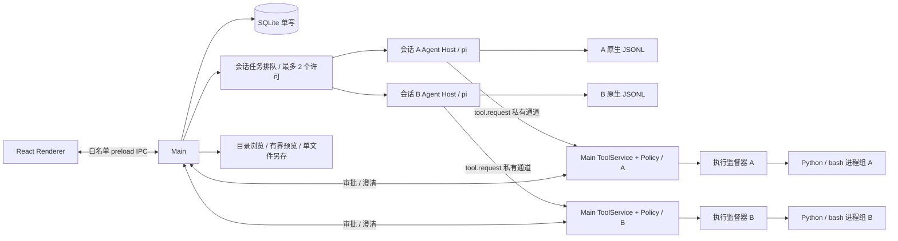

# 数据分析客户端：技术设计与验证

更新日期：2026-11-08。产品范围以 [产品说明](mvp-plan.md) 为准，交付阶段见 [开发计划](development-plan.md)。本文是唯一技术决策入口；原 architecture.md 仅保留跳转。`validation/` 中是可重跑的技术验证，不是已经完成的产品代码。

每会话单个追加式事件文件的后续设计见 [Session 追加日志设计](session-logging-plan.md)，目前待实施；本文其他章节仍描述已实现行为。

HTML 交互报告已接入独立 skill、内置 ECharts 与隔离查看器；验收范围与未通过项见 [实施计划](interactive-report-plan.md)。不固定报告布局，不定义报告 DSL 或组件生成器。

后续 UI 改动遵循 [设计原则](design-principles.md)；交付后的体验修复及草稿/附件状态调整见 [UX 修复计划](ux-remediation-plan.md)，UX 修复与 R1–R6 重构已完成；历史验收见 Git 与本地 test-results，当前回归入口见 [测试指南](testing-guide.md)；下文描述实际结构与契约。

## 1. 技术栈与运行边界

本产品是支持数据分析工作的通用 AI 工作台。应用管理执行、交互、文件与状态；CSV 解析、分析代码、业务口径和结论由 Agent 负责，不实现业务结果验证器或运行时 Judge。

采用单仓库、单 pnpm package 的 TypeScript Electron 应用。React + shadcn/ui + Tailwind，界面状态使用 React hooks，运行快照按身份/序号合并；流式 Markdown 使用 Streamdown；pi coding-agent SDK 直接运行于 utilityProcess；Main 使用 better-sqlite3 单写；Python/pandas/NumPy/Matplotlib/Seaborn、字体及通用搜索二进制随包提供。通用工具保持 read/write/edit/bash/grep/find/ls/ask_clarification。

electron-vite 构建 main/agent 两个 Node 入口，以及 preload/renderer；electron-builder 生成本机 `.app`。Python 可执行文件、标准库、扩展和字体放入真实资源目录，不塞进 ASAR。产品不要求用户安装 Node、Python、pip 或 Homebrew。

Renderer 保持 `nodeIntegration: false`、`contextIsolation: true` 与 sandboxed preload，只暴露有类型和参数校验的 IPC 能力。“不使用沙箱”指 Agent 工具执行策略，不意味着关闭 Electron 的渲染进程安全隔离。

运行目标：本机 macOS 15.7.4 / Apple M4 / arm64 / 24 GiB。首版本地 `.app` 验收不要求签名公证、Intel 或历史 macOS 兼容；不将未测平台标为支持。

已实测基线为 Electron 45.2.3（内嵌 Node 24.22.2）、pi 1.5.0、better-sqlite3 13.0.3、Streamdown 2.7.1、standalone CPython 3.12.12；正式工程从该基线开始锁定。完整依赖版本、实际命令、原始结果由 [验证入口与证据说明](../validation/README.md) 和各探针 lockfile 固定。源码依据为本地 pi commit `f9a26365568127461c47a07a37dcb42c140a3ac5`，探针使用的发布包版本须单独记录，不把 checkout 等同于 npm 发布物。

## 2. 进程、并发与职责



### Main

- SessionService：会话、workspace、原始 CSV 路径引用、删除/归档与恢复。
- RunAdmission：最多两个活跃会话的 FIFO 排队。等待审批/澄清仍占本会话许可；不是第三套模型轮次调度。取消排队任务不启动 Host；启动失败释放许可。
- RuntimeService / AgentProcess：每个活跃会话独立 Host、消息路由、生命周期、恢复和故障处理。其他会话浏览使用只读历史，不额外持有 JSONL 写者。
- storage/database.ts：SQLite 连接与 migration、外键、WAL、busy timeout；Main 服务单写，RunLedger 拥有输入账本的短事务。
- InteractionBroker：按 sessionId/runId/toolCallId 绑定审批与澄清；关闭窗口不取消，Cmd+Q/停止/崩溃取消。
- CredentialService：BYOK 加密持久化，只发送当前模型凭证到对应 Host；Renderer 不接收已保存的明文 key。
- file-selection.ts / SessionService：获取所选文件路径，检查真实路径、存在性、大小和合计大小。导入时不读取 CSV 内容、不解析、不生成表格预览；不复制源文件、不监测外部替换、不维护数据版本。
- WorkspaceFileService：按层浏览实际目录、签发临时条目 ID、有界预览与单文件另存；不依赖 Agent 执行、数据库文件索引或产物发布。

### Agent Host

一个 Host 对应一个活跃会话，持有 createAgentSession、SessionManager、受控 ResourceLoader、工具代理与当前执行投影。工具代理通过私有端口发送经过 schema 校验的 tool.request；实际文件访问、PolicyService、InteractionBroker 和 ProcessRunner 在 Main 执行。Main 从当前任务绑定 session/run/workspace/Host PID，不接受模型伪造这些上下文。Host 不直接写 SQLite。停止 A 只终止 A 的进程、审批和输入队列，不触碰 B。

pi 负责会话内部的 prompt/steer/followUp、重试和压缩；应用只做输入身份关联与外部会话准入。普通输入在空闲时开始新 run；执行中的 steer/follow-up 属同一 run、不同 inputId。全局排队任务重启后不自动恢复执行，保留为未发送。

### 执行监督器

不能依赖 Host 自己的 finally 回收所有子进程。执行监督器负责持有工具进程组，监视 Main/Host 存活，并在正常取消或父进程消失时 TERM，超时后 KILL。精确采用已运行探针验证的方式，记录 PID/进程身份，避免对复用 PID 误杀。

正常受控脚本及其同组子进程必须回收；不宣称能回收任意主动 setsid/逃逸进程组的恶意程序。执行监督器是生命周期机制，不是文件访问沙箱。

## 3. 源码目录与依赖方向

```text
data_agent/
  package.json / pnpm-lock.yaml
  electron.vite.config.ts / electron-builder.yml
  src/
    main/
      index.ts                  # 启动、单实例、窗口和退出生命周期
      ipc/handlers.ts / commands.ts / dependencies.ts
      services/                 # sessions, runtime, agent-process, interactions,
                                # credentials, file-picker, workspace, tools,
                                # policy, deletion, logs
      services/runtime/         # admission、run-ledger、lifecycle
      services/workspace.ts / tool-operations.ts
      storage/database.ts       # schema、migration 和 SQLite 连接
    preload/index.ts
    agent/
      index.ts / session-runtime.ts
      input-identity.ts / event-adapter.ts / history.ts
      models.ts / resource-loader.ts / redact.ts
      tools/ / tool-client.ts
      agent-configuration.ts / request-budget.ts / request-evidence.ts
    renderer/
      app/ / components/ui/ / lib/ / styles/
      features/                 # sessions、composer、models、runtime、workspace；各自拥有状态
    shared/contracts/           # Zod schemas + 可序列化命令/事件 DTO
    shared/models.ts / errors.ts
    node/                       # app-paths, runtime-paths, path-policy, read-text,
                                # output-budget, process-runner, session-integrity
  resources/
    skills/<name>/SKILL.md
    python/                     # 执行监督器等可信固定脚本，不含 CSV 预览/解析服务
    runtime-lock.json / requirements.hashed.lock
  runtime/darwin-arm64/          # 固定版本构建资源，生成物不提交
  scripts/build/ / scripts/test/ / scripts/eval/
  tests/features/ / support/ / fixtures/ / tooling/     # 按功能维护，catalog.json 注册；phases 仅历史留档
  evaluations/fixtures/ / rubrics/ / results/  # 独立 Judge 效果评测，不接产品运行时
  validation/                   # 本次已执行的独立技术验证，不作为产品运行入口
  test-results/ / out/ / release/
  docs/mvp-plan.md / technical-design.md / development-plan.md
```

Renderer 只依赖 shared/UI；preload 只提供窄 IPC；Main 与 Agent Host 通过 shared contracts 通信，不能互相 import 实现；shared 不依赖 Node/Electron/pi；node 是可复用基础设施。TypeScript 不能替代 IPC 运行时校验。Main 仅信任当前窗口的主框架，完整 URL 必须匹配；预期 URL 先用 WHATWG URL 规范化，兼容 Vite 的无末尾斜杠地址与 Chromium 的标准形式，不放宽为同源匹配。依赖方向用 lint 检查。

具体实现将准入/进程路由放在 `main/services/runtime.ts`，进程传输放在 `agent-process.ts`，凭证在 `credentials.ts`；Host 使用 `agent/session-runtime.ts`、`input-identity.ts`、`event-adapter.ts`、`models.ts` 和固定 `resource-loader.ts`。Renderer 的 `features/runtime/` 提供快照订阅与 Streamdown 过程展示；`features/composer/` 拥有草稿，`features/models/` 拥有模型设置。SQLite migrations 集中在 `storage/database.ts`；上面的目录树对应实际工程，没有为规划职责额外创建空模块。

P3 的通用工具由 `main/services/tools.ts` 统一执行；`policy.ts` 与可信 `resources/python/inspect_policy.py` 做非执行式检查，`interactions.ts` 负责一次性授权和澄清。Host 的 `tool-client.ts` 只传输工具请求/输出/交互，`tool.interaction` 进入 Host 快照后沿同一 seq 通道更新 UI，避免 Main/Host 各自递增状态序号。取消先由 Host 标记 SDK 中止，再等待 Main 的实际工具进程清理；普通用户停止不误报为模型失败。

`pnpm runtime:prepare` 从已校验缓存准备资源；干净机器显式运行 `pnpm runtime:prepare -- --download` 获取锁定资源，构建机需要 uv。脚本锁定 Python/rg/fd/字体哈希和 Python wheel 哈希，并生成完整运行时清单。`pnpm runtime:verify` 校验版本、每个文件哈希和符号链接；打包将运行时与辅助脚本放入 `Contents/Resources/runtime` 和 `Contents/Resources/python`，不依赖开发机 PATH 或 ASAR 内可执行路径。工具环境只含固定 PATH、工作区 HOME/cache/tmp 和受信字体配置，不继承模型 key。运行中的应用不下载或安装依赖。

## 4. 输入路径、存储和删除

业务状态默认位于 `~/.data_agent/`，测试用独立 `DATA_AGENT_HOME`。自选 workspace 和原始 CSV 路径是全局目录之外的合法引用。Electron userData 与业务数据根分离；测试同时隔离两者。

```text
~/.data_agent/
  state.sqlite
  sessions/{appSessionId}.jsonl
  workspace/{appSessionId}/
    analysis.py / report.md     # Agent 按任务生成的示例文件，并非强制清单
    figures/*.png / tables/*.csv
    .cache/ / .tmp/
  logs/{sessionId}/{sha256(toolCallId)}/{runId}.log
  backups/                     # 升级前一致性 SQLite 备份
  agent-resources/{sha256}/resources/skills/{skillId}/SKILL.md
# CSV 仍位于用户选择的原路径，不在这里另建 inputs 副本。
```

SQLite 仅保留 6 张应用表：

| 表                     | 职责                                                                |
| ---------------------- | ------------------------------------------------------------------- |
| schema_migrations      | 事务迁移版本                                                        |
| app_metadata           | 连接设置、加密凭证、模型偏好及缓存                                  |
| sessions               | 会话位置/标题/可用性、创建/删除标记、最新执行状态、配置绑定         |
| agent_config_revisions | 不可变提示词、工具及 skill 正文快照                                 |
| input_submissions      | 输入身份、接收顺序、执行 ID、ACK/entry ID/摘要及尚未落盘的正文/附件 |
| session_sources        | 按会话去重的历史来源路径，仅用于保护原文件                          |

sessions.state/error 表示会话可用性；run_id/run_state/run_error 仅保存当前或最近一次执行的身份、状态和错误。每次新执行生成唯一 runId，不另设 epoch；状态写入匹配 sessionId/runId，重启把未结束执行设为 interrupted，不重放任务。配置完全匹配修订时保存 agent_config_revision 引用；特殊旧绑定原样保存 agent_config_override，不能套用当前默认值。

input_submissions 按 sequence 保存全部执行的未确认输入；原生记录 ACK 后清空 pending_text/pending_paths，保留投递身份与 SHA256 摘要。未知输入不自动重发。session_sources 不是 UI 文件目录、当前选集或模型上下文；prompt/steer/follow-up 接收时和输入记录同事务追加路径。普通追问不 stat 全部历史来源。

每次添加和提交只校验本次附件的路径、存在性、单文件及合计 ≤100,000,000 bytes，不解析 CSV、不冻结内容。实际读取失败由工具返回。路径不是权限令牌，仍走 PolicyService。

迁移 11 在一致性备份后单事务合并旧元数据并删除冗余表，目标没有 tool_logs/output_versions/artifacts 及兼容视图。保留全部未确认输入、配置与原文件保护路径，废弃旧删除目标清单。迁移不打开或改写 JSONL，不搬移/删除 workspace 或旧日志。备份使用 VACUUM INTO，包含已提交 WAL，存于受保护 backups/；未知更高 schema 拒绝打开，失败回滚并报错。禁止用旧二进制打开新库；备份回退不等于后续 JSONL 一并回滚。当前完整字段、约束、关系与状态机见 [SQLite 表设计与状态机](sqlite-design.md)。

迁移 12 将 execution_id/state/error 统一为 run_id/state/error，input_submissions 的关联列同步改名；删除重复的 execution_epoch，以及没有读取用途的 started_at/ended_at/provider/model 执行字段。旧库升级前一致性备份，迁移事务失败则回滚；不改写原生 JSONL、模型上下文或工作区文件。模型/用量历史仍由原生记录恢复，run 时间字段不承担本轮用量耗时计算。

JSONL 是消息唯一事实源，SQLite 不另建永久完整聊天表。SessionManager 是唯一 JSONL 写者；Main 是唯一 SQLite 写者；二者没有跨介质原子事务。状态使用 creating/draft/persisted/missing 等，启动对账，不把 `message_end` 当落盘 ACK。

`appSessionId` 与 pi header ID 分开；用 `SessionManager.open(exactFile, sessionsDir, cwd)` 保持精确文件布局。草稿没有 JSONL 是正常状态；已有历史却缺失/零字节/损坏时不能静默新建。先只读预检和备份，再使用可能迁移文件的 SDK API。

删除会话先标记 deleting，阻止新输入、停止该会话并等待 Host/工具写者退出。仅清理固定路径的原生 JSONL 与新布局内部日志，之后删除 sessions（投递/来源记录级联删除）；配置修订保留。workspace 及原 CSV 始终保留，不扫描、不清理空目录，用户自行删除。内部文件清理失败把错误存入 sessions 并允许重启重试；清理必须校验根、路径、链接及与所有 workspace 的重叠。迁移后不执行旧 deletion_files 里的产物删除指令。

## 5. 命令、事件与运行状态

会话可用性、run 执行、输入投递以及内存交互分别建模，图示和持久化边界见 [SQLite 表设计与状态机](sqlite-design.md)。

IPC 命令携带 requestId/sessionId；输入另带 inputId。当前 Host 通过 `runtime.event` 发送白名单 `snapshot` 对象，包含 schemaVersion/sessionId/runId/seq 与完整可序列化投影；控制命令另有按请求 ID 关联的响应。每个 run 独立 seq 水位；非当前 run 的推送不得直接替换前端投影，只能重新请求 Main 权威快照。Main 同时校验当前任务对象、sessionId/runId 与 seq，拒绝旧 run 的迟到事件。当前不支持保留 runId 重启执行进程；重新执行必须生成新 runId。

- `message_update` 的 text_delta/thinking_delta/toolcall_* 驱动正文与准备调用。
- `tool_execution_start/update/end` 驱动工具状态，用 toolCallId 关联。
- `message_end` 用最终消息校准 UI；持久化确认需另外取得。
- `queue_update` 辅助显示 SDK 队列，不作为输入身份事实源。
- retry/compaction 显示状态；`agent_end` 不一律代表最终完成。
- `agent_settled` 表示已经启动的持续执行收束；prompt/preflight rejection 也必须单独处理。

运行状态：queued → starting → running / waiting_approval / waiting_input → 终态 completed/failed/cancelled/interrupted。取消过程中等待实际工具回收，不单独持久化 cancelling 状态。run 启动失败或最终终态时释放会话准入许可；单工具失败或审批拒绝只结束该工具/交互，SDK 继续时不能释放许可。执行状态以 SDK/进程的实际生命周期为准，不以自然语言声明推断，也不据此判定分析正确。

运行终态与文件展示分开：sessions.run_state / RuntimeSnapshot.state 记录 SDK/进程生命周期；WorkspaceFileService 返回当前文件及预览提示，不持久化 ready/published 状态。不存在报告不改写已结束的执行状态，普通聊天允许没有产物。测试可以约定 report.md 非空，产品不据此判断分析正确。

Host 内保留可序列化的活动投影；快照 = 当前分支持久化历史 + 活动 partial/tool/interaction/queue + seq 水位。Renderer 重载恢复该快照，再补后续事件；Host 崩溃不承诺恢复尚未落盘的每个 token。

SDK partial 是可变对象，订阅回调立即复制所需字段；以约 30–60 ms 合并 UI 更新，有界日志和结果，避免逐 token 写 SQLite。模型请求在 Host，不把 Renderer Network 面板当模型请求证据。

## 6. pi 输入身份与恢复

SDK 原生 steer/followUp 没有应用 inputId 参数；同文本消息不能靠正文或 queue_update 字符串去重。必须采用已实测的身份桥接方案，保留 SDK 原生树格式，通过 SDK 公共入口写元信息；不能给 SDK 私有字段打补丁或另建聊天正文事实源。

已运行的方案是应用给每条用户输入添加唯一外层 envelope，由可信 context hook 在模型请求前只剥除最外层，Renderer 同样还原原文；JSONL 保留标准 message/custom entry。SessionManager 的 custom entry 记录 submitted 与 committed(inputId→entryId)，不复制正文。用户自己写的类似标记仍保留为原文，不作为控制信息。

在 turn_end/agent_settled 或命令最终收束后读取实际 JSONL record 确认映射；恢复先加载已有 committed，再幂等补缺失映射，不反复 append 同一 ACK。应用生成 UUID 并校验登记表，只信应用外层标记。本次确认是完整 record 可读，不声称 fsync 级断电耐久性。具体格式、上下文处理、相同文本与恢复结果见 [验证入口与证据说明](../validation/README.md)。应用自带的可信身份 hook 可以显式加载；关闭的是宿主/用户的自动资源发现，不是禁止应用自带适配代码。

确认持久化后才把 input 标 committed；未知结果标 unknown，不能自动重放。abort 后显式清 SDK 队列，未消费输入保留未发送。同一文本的两次用户输入仍是两个 inputId。

Main 在接受输入时原子登记 input_submissions 与 session_sources，再交给 Host；全局排队时同样保留文字。重启后只读原生历史对账 committed，清空已落盘输入的 pending 正文/路径；剩余未知/取消输入通过 Main 的 unsentInputs 投影呈现，可放回输入框或显式移除，不自动重发。未发送输入跨后续 run 保留，移除按会话和 inputId 校验，不能删除活动队列中的输入。JSONL 仍为唯一永久会话内容。用户主动停止会清除暂时性模型错误，以 cancelled 收束；运行超时保留限额错误，以 failed 收束。

### 上下文稳定性与执行限制

不再注册逐请求追加动态 system 消息的 context_with_system hook。工具结果由 pi 正常追加；附件路径经 InputIdentity 随对应用户消息投影，后续恢复保持相同位置与表示。新会话固定 system prompt/cwd/工具声明/skill 声明，预算变化不进入上下文。请求上限通过 streamFunction 入口拦截第 51 次调用（含重试），活跃执行时间和工具超时由监督机制停止；仅 UI 显示限制错误。不依赖 SDK 扩展抛错来阻断，因为某些扩展错误会被 SDK 捕获后继续请求。

恢复旧会话时复用原生历史中的 system preamble/cwd，不能为升级改写已发送前缀。旧 cwd 为 run/version 目录的会话只追加一次原生隐藏 custom_message `data_agent.workspace_migration` 说明后续改用共享目录；保留原位置，重启不重复添加。这是迁移兼容，不是逐请求状态提示。新会话没有此消息。上下文压缩是唯一允许重建前缀的例外；当前提供方最终序列化请求的前缀由测试直接比较，不能仅检查中间消息数组。服务端缓存命中仍受提供方策略影响。

## 7. 通用工具、资源和模型

tools 使用明确名称白名单，customTools 提供受控实现；`tools: []` 不能作为“只关 builtin”的写法。Main 按 run 串行执行，两会话间可并发。大文件 read 使用有界流式读取，不能复用“读全文后截断”处理 100 MB；数据集计算与抽样仍由普通 bash 和内置 Python 完成。

### 工具契约、分页与输出预算

`shared/tools.ts` 的 Zod 参数契约同时生成 Agent 的 JSON Schema 和 Main/Host 的运行时校验；Agent 不再维护另一份 TypeBox 参数定义。工具顺序从同一参数集合导出。UTF-8 写入/编辑的每段文本按编码后 256 KiB 校验，JSON Schema 的字符长度约束是额外上界，工具说明明确字节语义。错误通过 SDK 原生 `isError` 返回，保留受类型约束的 details，不通过抛异常丢弃退出状态与截断信息。

`shared/tool-limits.ts` 集中固定策略：参数大小、读取/搜索预算、日志配额、超时、产物资源和模型执行预算。它们不是新增用户设置；工具调用的 limit/offset 只在硬上限内调整。Main 经私有配置管道把产物条目/字节和进程内存上限传给 Python supervisor，避免两种语言重复维护执行数值。UI 字符显示上限独立于模型输入预算。

- read 默认最多 200 行、正文最多 48 KiB，offset 为从 1 开始的行号；byteOffset 为从 0 开始的 UTF-8 字节位置，两者互斥。截断结果明确给出 nextByteOffset，模型可按提示继续，长单行也不重复或跳过字节。每次行定位扫描最多 8 MiB；字节定位直接从指定位置读取，因此可以到达更大文件及日志的尾部。游标不冻结文件，文件在两次读取间被外部修改时不承诺一致快照。
- ls 默认 500 条，find 默认 256 条，可用 limit/offset 分页，输出同时受字节限制。ls 按名称排序；find 使用文件名正则、相对路径，最多扫描到 5,000 个候选。find 的 NUL 路径记录、grep 的 JSON 行必须完整解析后才能进入展示分页，截断的最后一个机器记录不当成路径或匹配。
- grep 默认总计 100 个匹配，支持 limit/offset、ignoreCase 与 literal；不再静默限制每文件前 30 个匹配。遍历仍限 256 个文件/5,000 个条目，单行展示最多 500 个 Unicode 字符。搜索原始捕获最多 2 MiB，达到上限停止搜索进程，并明确标记搜索范围不完整；这不是进程错误，也不声称没有其他匹配。范围截断后应缩小目录或 pattern，分页仅覆盖当前有界扫描范围。
- 单工具最终正文最多 64 KiB；同一 assistant 工具批次按调用数量分配合计 256 KiB 返回预算，在执行前通过私有 Host 请求传给 Main。读取/搜索提前预留提示空间，继续位置对应实际返回内容。预算不足以执行时返回有界错误，请求减少批次调用；不先执行副作用再丢掉结果。Main 在 IPC/原生历史之前执行最终字节上限检查。

批次预算仅控制新增工具正文，不等于模型 token 上限；调用参数与历史仍占上下文。继续使用 pi 原生工具轮次间压缩和溢出恢复，显式配置 reserveTokens=16,384、keepRecentTokens=20,000。预算不作为动态提示词注入，不删改已发送结果。最终 HTTP 请求回归覆盖预算变化、工具循环、steer/follow-up、共享目录、新附件和重启；压缩才允许重建前缀。

工具执行按职责分为 ToolService 的策略/审批/取消、ToolOperations 的穷尽分派、file-tools 的写入/精确编辑、search-tools 的完整记录解析及分页，以及 node 的读取/输出捕获。新会话使用当前工具契约；历史会话的工具声明必须与当前契约及顺序完全一致才能继续运行，不提供旧版声明兼容。声明不一致时保留历史并停止新任务，提示新建会话，不改写 system/tools/history，不新增 SQLite 表或会话格式。

ResourceLoader 只返回固定 skills/system prompt 和应用自带 hooks；SettingsManager、模型配置、agentDir、session 文件均显式指定，避免读取 workspace/global `.pi` 的任意扩展与配置。分析 skills 指导 Agent 自主写脚本，而不是把业务步骤固定为工具 API。

模型 UI 仅开放 DeepSeek/OpenRouter，使用 `/models` 返回 ID 与锁定 pi 聊天模型目录的交集，展示 SDK 能力与验证状态；不伪称每个模型都支持 thinking、视觉或所有工具行为。非视觉模型不发送不支持的 image content；PNG 照样由产品展示。模型、Base URL、key 和思考级别在提交时绑定到 run，排队或运行期间更改设置只影响之后的新任务。可选思考级别直接取锁定 pi 版本的 `getSupportedThinkingLevels`，不支持思考的模型隐藏控件；每个模型独立保存选择。DeepSeek-V41-Flash 标明已验证基本流程，其余模型显示未验证兼容性；这不是分析正确性标识。

模型设置的 `ModelPicker` 将搜索与选择合为一个入口，使用锁定的 Radix Popover 1.1.15 和 cmdk 1.1.1。弹层内搜索当前提供方的缓存列表（名称/ID），未确认前不改变已保存模型；打开聚焦搜索框，支持键盘移动、输入法确认保护、Escape 和选择后的焦点恢复。弹层按视口避让并限制高度，列表独立滚动，沿用现有主题。目录获取、保存与 IPC 合同不变。

SDK 在 Main 调用前生成的参数校验错误可能包含整份 Received arguments，也受相同结果预算约束。Host 在新 toolResult 的 message_end、首次写入原生历史前补做字节限制；不通过 context hook 改写既有结果。只读 SDK 测试入口也在读取前接受批次预算，续读位置不会指向被 Host 再次省略的正文之后。

### Agent 配置与会话固定版本

`shared/agent-config.ts` 定义唯一的配置与快照结构：行为指令（最多 32,000 字符）、固定工具 ID 和内置 skill 开关。`resources/skills/catalog.json` 是内置 skill 唯一登记清单，按登记顺序提供 ID、显示名称、references 文件和锁定运行时资源名称；只接受清单内的 ID，skill 开启要求 read。新增 skill 只需增加清单条目及其文件，不修改提示词、加载器或设置页的分支；仍不加载用户目录或第三方扩展。

`composeAgentPrompt` 只组合可编辑行为、固定工作区与输入文件约束、与启用工具一致的环境说明。主提示词不包含具体 skill 名称、选择分支、分析流程或交付格式。适用场景在各 skill 的 description 中声明，SDK 将已启用索引与通用按需读取说明加入 system；方法和交付规则在 SKILL.md 正文中维护。预览与执行使用同一套组装逻辑，不保留提示词协议多版本、旧默认值或旧提示词恢复分支。

`main/services/agent-config.ts` 是 SQLite 唯一写者。agent_config_revisions 保存不可变配置修订，sessions 只引用修订；snapshot 包括配置、skill 正文/描述/路径/哈希和指纹。修订号用于保存冲突检查及会话固定，与提示词协议版本无关。最新修订作为默认值；无实际变化不增修订，保存使用 expectedRevision 拒绝过期覆盖。初始化和保存均在 SQLite 事务内，会话创建事务同时写入绑定，首次输入排队前即固定配置。

Main 按清单从可信资源目录加载每个 skill 的 SKILL.md、references 和已锁定的 runtimeAssets，不按 skill ID 分支。无附带资源时用正文哈希，有资源时将排序后的资源描述与正文哈希合成 bundleHash，再物化到 `agent-resources/{hash}/resources/skills/{id}/SKILL.md`。正文与小型 references 随快照保存，大型运行时资源只保存路径、字节数和 SHA-256，并从相同哈希的可信安装资源恢复；符号链接、篡改和资源缺失均拒绝。文件物化后 DB 事务失败产生的孤立缓存不改变默认配置。已保存的 skill 内容保持冻结；应用升级不隐式修改已有会话或配置，明确关闭、保存后重新启用可采用当前资源。

Host 接收配置快照，只声明/注册启用工具；ResourceLoader 只返回启用 skill 的元数据，正文继续按需 read。Main 使用会话绑定再次检查工具名。普通产品 Host 始终带配置与工具代理；低层测试的无配置入口也复用同一个 composeAgentPrompt，不再维护另一套默认提示词。

原生 JSONL 的 custom entry `data_agent.agent_config` 只记录修订与指纹，不进入模型上下文。启动时校验 SQLite 绑定、快照和原生标记，再比较已发送的完整系统段与工具声明顺序。不支持的旧快照、缺失绑定或已发送前缀不匹配时停止并保留记录，不恢复、改写或升级旧提示词；存储层遗留的 agent_config_override 字段不再读取或写入。只保留当前快照结构，不自动迁移旧状态目录。会话内工具循环、预算变化、steer/follow-up、新附件与重启均不得改写既有请求前缀，压缩是唯一允许重建的场景。

Renderer 的通用设置壳位于 `features/settings/`，分模型与连接、Agent 配置、本地与诊断；Agent 编辑与只读会话详情位于 `features/agent-config/`。IPC 为 `agentConfig.get/save` 和 `sessions.agentConfig`，Renderer 不提供文件路径。编辑页保留跨分类草稿，关闭时确认未保存修改，统一保存/撤销；默认版本与会话实际版本分别显示，旧版本不视为故障。

完整提示词预览通过 `agentConfig.preview` IPC 交给 Host；Main 验证草稿与默认修订号并提供可信 skill 元数据，Renderer 不拼接提示词或导入 SDK。`agent/workbench-session.ts` 的 `createWorkbenchSession` 是正式执行和预览共用的 SDK 创建入口，统一 ResourceLoader 与工具注册；`configurationResources` 提供相同的 preamble 与 skill 描述。SDK 1.5.0 没有公开独立的 prompt builder，因此预览使用显式内存 SessionManager/SettingsManager、无凭证且禁用网络发现的 ModelRuntime、无扩展和拒绝执行的工具代理，从 SDK `session.systemPrompt` 取得真实文本后立即 dispose；不调用 prompt、不创建文件/进程或请求模型。仅展开时加载，编辑防抖 250ms，旧请求结果不能覆盖新草稿。工作区使用绝对占位路径，skill 使用当前修订的可信快照路径；保留 SDK 的 `<skills>`、`<available_skills>`、`<cwd>` 标签与顺序。工具参数另在 API tools 字段，不伪装成系统提示词内容。

会话详情优先使用原生 JSONL 投影的 `getCurrentSystemMessage` 与 SDK `getSystemMessageText`，显示已记录的当前系统提示词，不能按最新模板重建历史。尚无系统记录才用该会话绑定配置组装，并标明来源；读取不修改 JSONL。此调整不改变已有发送内容、配置修订或前缀。

开发服务使用构建配置提供的资源根，避免 Vite `--entry` 使 `app.getAppPath()` 指向构建入口后找不到内置 skill/runtime；真实目录只在 serve 模式注入，生产构建为空字符串并使用应用自身资源路径，不将开发者绝对路径带入 .app。恢复会话时校验完整系统段（含顺序）和工具声明，不删除无法识别的历史段；不兼容时停止并提示配置待确认。

本地真实测试固定：

| 配置             | 值                                  |
| ---------------- | ----------------------------------- |
| 显示名称         | DeepSeek-V41-Flash                  |
| provider / model | deepseek / deepseek-flash           |
| base URL         | https://api.deepseek.com            |
| key 来源         | `~/.zshrc` 中的 `DEEPSEEK_API_KEY`  |
| 思考配置         | enabled / high，由实际 SDK 请求验证 |

`deepseek-flash` 为服务端可更新别名，记录请求/响应模型和日期；thinking+tools 后续请求由 SDK 保留 reasoning_content，不从 UI 重建。[DeepSeek 官方](https://api-docs.deepseek.com/)、[thinking/tools](https://api-docs.deepseek.com/guides/thinking_mode/)

产品不执行用户 `.zshrc`；本地测试启动器单独获取该变量，不打印环境集合。Main/Host 私有通道传凭证；工具执行环境为白名单，无 key。生产 BYOK 用 safeStorage 加密，不把 key 保存到 JSONL/报告。

## 8. PolicyService 与审批

统一入口先做 schema、真实路径和命令/脚本检查，再 allow/ask/deny。文件路径使用 realpath/最近现存父目录，按目录归属判断，不用字符串前缀。源/目标均检查；执行前复核解析路径和脚本摘要，仍不声称消除所有竞态。

| 规则                                   | 决定                                                           |
| -------------------------------------- | -------------------------------------------------------------- |
| 普通外部读、正常内部读                 | allow                                                          |
| 普通 workspace 内新文件写入            | allow                                                          |
| 已声明源 CSV 的可识别修改              | ask，即使源文件恰好位于 workspace 内也不默写；默认分析写新产物 |
| 旧版历史目录产物的可识别修改           | deny；会话共享目录的当前产物允许更新                           |
| state/sessions/凭证配置、敏感路径      | deny 读写                                                      |
| 检测到 workspace 外写删                | ask                                                            |
| 已识别 curl/wget/requests/httpx 等联网 | ask；说明可识别的目标和动作                                    |
| 明确破坏系统、安装依赖/修改内置运行时  | deny                                                           |
| 可识别动态执行、无法解析的写入目标     | ask                                                            |
| 检查器异常                             | deny/error，不静默放行                                         |

敏感路径基线覆盖应用凭证/控制文件、用户 SSH/云凭证、shell 启动文件及 `.env` 等显式凭证文件；在规则版本和样例表中列出具体模式。外部读取默认允许不等于允许读取这些文件。模型 API 为应用已配置行为，不通过工具联网审批反复询问。

静态 shell cd 追踪后续命令的目录，外部只读检查照常允许；未解析的目录变化仍需确认。脚本分析不执行导入；对常见 open/Path/to_csv/savefig/delete 等识别路径，正常可解析输出避免误报；未知代码不能被宣称已完整分析。正则与有界语法分析只能提供尽力检测，任意导入、别名、原生库、动态网络和进程组逃逸不属于可保证覆盖。

审批凭据绑定 session/run/toolCall、参数、脚本 hash、规范路径、网络摘要及规则版本，原子消费一次；修改、停止、崩溃、Cmd+Q 后无效。关窗口保留等待。恶意文件内容不产生用户批准，不允许将工具输出当授权来源。

实际的路径/审批与分类器探针见 [policy/probe.py](../validation/policy/probe.py)；探针是有限规则机制证明，不是完整生产规则集合。

## 9. 工作区浏览与文件展示

同一 session 的 prompt、steer、follow-up 共用固定 workspace。新执行只更新运行身份，不生成版本目录或发布清单；system prompt 与上下文前缀保持稳定。任务收束仍等待 Host/工具退出，但不等待目录登记。

WorkspaceFileService 按层异步列目录，每层最多 2,000 条并明确提示截断；目录展开才读取，默认隐藏点文件，可显示隐藏文件。符号链接及特殊文件不跟随，不支持项明确标注；敏感内部路径拒绝。条目 ID 存 Main 有界内存（10,000 项），不写数据库、不跨重启承诺有效。无 Agent 任务时也能查看手动文件。隐藏面板不扫描；打开、手动刷新和工具/执行终态触发合并刷新，保留当前选择，不自动选择新报告。

workspace.list/resolve/preview/copy/reveal/saveAs 接口只接受会话及 Main 签发条目 ID；resolve 仅解析选中文件旁的相对链接。Main 检查根身份、会话归属、规范路径及普通文件，拒绝路径逃逸、敏感目录、链接替换及读取中修改。Renderer 不提交任意绝对路径。外部附件只在用户消息中显示路径，不作为目录条目或增加“解除关联”。

文本预览最多 128 KiB / 2,000 行，UTF-8 截断保留完整字符；非 UTF-8、二进制及未知扩展名提示原因。Markdown 小于等于 2 MiB 时安全渲染，超过则有界文本预览；空文件明确提示。SourcePreview 使用 highlight.js 11.11.1 core 和显式语言包，只生成转义标记，最多高亮 32,768 字符，不自动猜语言、不解析 CSV、不执行代码。PNG 限 25 MiB、4,000 万像素并实际解码。深浅主题使用现有 tokens。

WorkspacePanel 提供文件/预览 tabs、可调宽度、展开阅读、独立滚动、复制展示内容、Finder 定位和单文件另存。Markdown 可切换源码；WorkspaceReport 禁止 raw HTML、外部自动图片与危险 scheme，相对图片/链接通过同一工作区受控接口解析，HTTP(S) 外链需显式点击。刷新可显示原路径新内容，不再依赖永久 hash 登记。

“另存文件”由原生保存对话框选择目标，文件最大 500 MiB，以同一个校验后的描述符分块 64 KiB 复制到临时文件，检查源/目标变化后提交；异常清理本次临时文件，不覆盖源文件。只复制选中的文件，不批量打包相对图片。需要整个目录时通过 Finder 操作。旧版本目录如在 workspace 内，仅作为普通目录；无版本选择器、版本导出或旧索引兼容。

工作台检查文件访问、尺寸与安全渲染，不检查报告业务数值或代码正确性，也不要求 metrics/manifest 文件。Agent 自建 manifest 只是普通文件。语义效果由独立 Judge 评价。

### 隔离 HTML 查看器

`report.open/layout/close` 复用可信主窗口 IPC，使用 sessionId、条目 ID 与一次性 viewer ID，不接受 Renderer 提供 HTML 正文或磁盘路径。WorkspaceFileService 对 `.html/.htm` 完整有界读取，复用文件身份/归属/链接竞态校验，拒绝空文件、无效 UTF-8、NUL 及超过 32 MiB 的文件，不截断后执行。HtmlReportService 串行完整读取、丢弃过期请求；全局仅拥有一个报告 view，旧 close/layout 不能影响后继。

Main 为每次打开创建独立 WebContentsView 与非持久化 session。`data-report://document/{uuid}` 仅提供该次已验证的内存字节，无文件映射；仅允许精确文档的主 frame GET。无 preload、Node 或业务 IPC；sandbox/contextIsolation/webSecurity 均开启。响应 CSP 只允许内联脚本/样式及 data 图片/字体，禁止 eval、外部脚本、connect、frame/object、worker、base、form。独立 session 拒绝额外请求、设备权限与下载，阻止弹窗和跨文档导航，保留页内锚点。WebRTC 禁用非代理 UDP，并为该 session 设置无绕过的封闭本地代理；不改变主窗口网络配置。错误仅发有界通用摘要并去重，不转发报告原文。

HtmlReport 只计算宿主槽位并发送有界位置；Main 再裁剪到窗口范围。调宽、展开、源码切换及隐藏不重建页面；实际可见的宿主弹窗/菜单/提示浮层出现时隐藏原生 view，避免遮挡。已关闭但保留在 DOM 中的弹层不影响报告显示；原生 popover 的 toggle 事件也触发布局更新，关闭后恢复原 view 和交互状态。选中文件/会话变化、会话删除和主窗口关闭销毁 view；显式刷新重新读取并重置交互。目录自动刷新不重载 HTML。关闭视图不停止 Agent。主 Renderer/Markdown 的 CSP 和 raw HTML 禁令保持原样。

`interactive-report` 的 SKILL.md 与简短 references 随配置快照保存；vendor/echarts.min.js、LICENSE、NOTICE 只记录路径、字节数和 SHA-256。资源集合按路径排序并规范化字段顺序参与 bundleHash；物化先校验再以临时文件提交，不接受链接或篡改字节。附带资源通过唯一快照结构的 assets/bundleHash 冻结。缓存保留；缺失 vendor 只从相同哈希的安装资源恢复，否则报配置待确认，不能替换库版本。报告自身已内嵌资源，不受生成资源缺失影响。文件缓存与 SQLite 不是跨介质原子事务，无引用缓存可保留。

ECharts 6.1.0 锁定为构建依赖，resources/echarts-lock.json 固定浏览器分发与许可哈希。scripts/build/report-runtime.mjs 在构建与正式测试准备阶段从锁定依赖复制到 runtime/report-runtime，已有不一致文件拒绝覆盖；升级时清理这份可重建目录后重新准备，不清理用户 agent-resources。electron-builder 复制到 Contents/Resources/report-runtime，verify-release 检查实际包内字节。运行时无 npm/CDN 下载；库不进入主 Renderer bundle，也不读入模型上下文。Agent 用 Python 装配自由 HTML，局部参考文档不规定报告结构。

导出是宿主另存单个 HTML，外部浏览器不再受应用内 session 策略管理。32 MiB 是有界读取合同，不是任意脚本性能保证；大数据由 Agent 按意图聚合/抽样。普通源码复制仅复制截断文本，不能充当报告导出。

## 10. 执行限额与可观察性

产品默认值：单工具执行 180 秒；单 run 活跃执行时间 10 分钟、最多 50 次模型请求；HTTP 暂时性失败最多重试 2 次且计入限额。工作台不判定业务错误或统计“业务自修复次数”；Agent 可在总预算内自行修复代码或解释无法完成的原因。等待用户审批/澄清不计活跃执行计时，但继续占会话名额，可显式停止。截断日志不截断错误状态。

不向模型注入剩余请求次数提示。内置 skill 仅提供通用分析与交付指导；50 次硬上限由请求入口阻断，错误状态不因模型声称完成而改变。

bash 的 stdout/stderr 按 Main 接收顺序合计不超过 2 KiB 时完整返回，不创建日志文件或调用目录；超过后返回 UTF-8 字符边界内的头尾合计最多 2 KiB，加上截断提示与已实际写入的日志绝对路径供 Agent 按需 read。日志包含触发阈值前后的输出字节，每 run 所有 bash 合计最多保留最早 10 MiB，超出部分继续消费但不再写盘；额度不足或写入失败须明示不完整，完全未保存时不给出虚假路径。日志写入失败不改判进程退出状态。grep/find 的原始捕获与模型输出分别有界，完整记录解析后分页，不写进程日志。UI 只显示工具结果，不提供独立日志正文、入口或日志读取 IPC。会话初始加载最近 10 个完整用户轮次，每次向前加载 10 轮并保留滚动锚点，不在一轮的工具序列中间截断；回答正文连续渲染。Renderer 的 transcriptTurns 以用户消息为边界汇集后续 assistant 消息（包括多次模型/工具步骤）；分组使用稳定 inputId（旧记录回退消息 ID），工具行使用 toolCallId，避免 SDK 终态恢复原生 JSONL entry ID 时重建控件丢失焦点。ExecutionProcess 将 thinking/toolCall 按原顺序放进同一折叠区，toolResult 通过调用 ID 关联，正文消息保留在区外。活动轮默认展开，后续用户消息或运行终态使其自动收起；运行中手动收起不受流式更新覆盖，结束后手动展开不受后续快照覆盖。审批/补充问题继续由 RunControls 独立展示。思考和原始工具输出详情仍独立分页。执行过程分组不改写原生消息；用量统计另通过下述 custom entry 标记轮次边界；插话/后续提问按实际进入原生历史的用户消息划分。阅读历史时不自动追到最新，底部独立箭头返回末尾。预览可拖拽/键盘调宽或专注阅读，窄窗口采用覆盖层。JSONL 保留完整消息。单 PNG 最大 25 MiB/40 百万像素，超限不给 Renderer 解码。生成数据可超过输入体积但需按输出限额及时终止；会话工作区文件总量上限 500 MiB（跨 run 累计）。写入前做有界目录计量；执行 bash 时由监督器每约 250 ms 及退出时检查总量/条目，超限停止进程并返回明确工具错误，保留已有文件。该检查是尽力检测，不是 OS 磁盘配额，也不能承诺阻止两次采样间的瞬时超量。超限返回明确错误，保留已完成产物状态，不偷偷改用其他模型或无界重试。

100 MB / 180 秒 / Python 进程树峰值 RSS 2 GiB 是代表数据的基准目标，不是任意 CSV 形态的保证。基准必须固定字段分布、任务、计时范围和采样方法；并发两个任务另记录总资源。CSV 输入大小不能限制 join 中间结果大小，运行时需监测并明确失败。正式 P6 基准由 `tests/features/performance/large-input-scenario.mjs` 固定生成两个各 50,000,000 bytes 的表（128-byte 定长行，三个月、四地区），通过实际文件选择、pi 工具和内置 Python 完成读取、合并、汇总、绘图和报告交付。计时从 UI 发送到 run 终态，排除生成 fixture/选择文件；每 100 ms 独立采样应用后代 RSS，并记录生产监督器的单工具进程树峰值。30 次 CDP 面板操作的耗时和执行时任务是否仍活跃均留证，程序不检查汇总数值正确性。实际数字见本地阶段结果。

结构化日志含 session/run/tool/input，避免跨会话串联；脱敏 key/header，保留有限错误、退出码、耗时、版本与 artifact hash。指标和审批信息不是 assistant 正文，不伪造为 thinking。

## 11. 测试与证据的解释

- 程序/规则化验证负责 SDK 接入、真实模型调用链、Electron/CDP、SQLite/打包、内置 Python、文件交付、审批机制与进程回收；不校验分析数值或结论。确定性模型响应覆盖状态和错误分支，live 用例验证真实调用与文件交付。
- 正式产品开发把这些已验证的机制接入真实界面与生命周期，再运行产品 CDP/E2E。探针通过不是宣称所有 UI 或产品功能已完成。
- 主 E2E 保留真实 Electron/Main/pi/工具/Python/SQLite/JSONL，只可替换外部 LLM 响应做确定性故障回归；真实 DeepSeek 路径另测。
- P3 确定性 CDP 用本机 HTTP/SSE 模型夹具，保留真实 pi SDK 与全部副作用链路。仅 `--data-agent-automation` 可接收 `DATA_AGENT_TEST_MODEL_BASE_URL`，Host 再校验其必须为 `http://127.0.0.1`；普通启动忽略该变量。关闭/重开、退出、查询任务 Host PID 的自动化 IPC 同样只在显式测试模式注册处理，不能授予工具权限。
- 使用独立 userData、业务根、workspace、端口。CDP 仅显式测试模式、loopback，正常启动关闭；真实密钥不进入 Renderer。
- `connectOverCDP` 能力低于 Playwright 原生协议；本项目以实际连通/操作/截图结果为依据，不承诺所有高级功能。[Playwright](https://playwright.dev/docs/api/class-browsertype#browser-type-connect-over-cdp)
- 离线资源测试必须证明外部连接失败仍能运行分析；临时测试环境的网络限制不成为产品执行安全策略，不把只拦 Chromium 请求当作阻断 Python/Node。
- LLM-as-a-judge 单独读取任务、输入数据、执行记录和产物，评价 Agent 的方法、数据处理、结论依据与解释；当前由开发协作中的 AI Agent 执行，允许独立计算辅助判断。评测分数不写入产品完成状态，也不阻塞文件展示。
- 旧探针中的 oracle/业务 schema/报告数值断言仅保留为历史实验，不迁移为工作台逻辑或程序验收门禁；已有通过记录也不能冒充已完成 Judge 评测。

本次各项最终状态、命令与限制统一见 [验证入口与证据说明](../validation/README.md)。程序验收和独立 Judge 评测步骤见 [开发计划](development-plan.md)。

## 外观与输入交互

Renderer 使用统一语义颜色变量，覆盖聊天、设置、审批与文件预览，PNG 不做反色。默认深色；右上角切换 dark/light。主题偏好以 `data-agent.theme` 存在 Electron userData 下的 localStorage，渲染 React 前应用到根节点以减少启动闪烁；它是界面偏好，不写入会话 JSONL 或业务 SQLite。存储不可用时仍允许本次窗口切换。

输入框 Enter 发送、Shift+Enter 换行，兼容 ⌘ Enter。组合输入期间（composition 状态、isComposing 或 keyCode 229）及按键重复不发送；发送按钮与快捷键共享可发送条件，并用同步锁避免重复提交。空白输入不提交。

## 工程重构增量（2026-11-07）

IPC 入口为 main/ipc/handlers.ts，仅负责来源/命令校验与错误映射；commands.ts 分派业务，dependencies.ts 定义必需的命名依赖。shared/contracts/ipc.ts 的 CommandResponses 将每个命令绑定到返回类型，Renderer 不再提供任意 request<T>。Host RPC 同样校验响应类型。测试 runner 使用 scripts/test/run-context.mjs 独立构建与生产依赖打包，不覆盖共享 out/release；复用构建需要源码指纹一致。

### 草稿与提交接收（UX2，2026-11-07）

Renderer 的 `features/composer` 拥有每个会话及首页的草稿，存于当前 Electron userData 的 localStorage（`composer-drafts-v1`，Zod 校验）；文本、路径元数据、工作区选择可恢复，不含 key、不复制 CSV、不创建正式 sessions。输入框只显示待提交附件。文本 revision 与附件 token 用于接收时精确清除，期间新增内容不丢失。删除会话成功后同时移除该会话的本地未提交草稿，首页及其他会话草稿保留。

`files.choose/files.inspect/workspace.choose` 只选择/校验。`conversation.submit` 先校验模型、凭证、原路径和合计大小，再创建会话并进入现有 RuntimeService/pi 队列。原 `sessions.create` 保留给存储恢复与集成 fixture，产品“新会话”不再调用它。首次接收用首个 inputId 作为 session ID，标题取问题前 48 字。

input_submissions 的 inputId + digest 保证提交幂等，相同请求返回接收结果、不同内容拒绝。sessions.creation_pending 替代创建意图表。首次创建失败或重启仅回收未接收的空目录（rmdir，不递归删除未知文件）；已有执行只清标记。投递身份、待确认正文/路径和来源保护在同一 SQL 事务写入；不把 SQLite 与文件系统/JSONL 伪装成同一事务。

pi JSONL 仍用原生 message/custom entry，`data_agent.input_submitted` 增加 paths 元数据；模型上下文注入本条原路径，Renderer 显示对应附件，重启可还原。附件随消息保留，不提供独立关联/解除关联功能。模型配置由 `features/models/use-model-settings` 串行持有，输入区与设置共用 busy、值及错误，设置错误在弹窗内显示。

### 生命周期、资源及展示所有权

- `runtime/admission.ts` 持有最多两个运行许可及 FIFO；`run-ledger.ts` 只在状态/ACK 变化时写元数据，文本 delta 不重复写 SQLite；`lifecycle.ts` 等待 Host 写者和工具，再清理计数并释放许可。RuntimeService 保留公开用例入口。终态 task/恢复 snapshot 缓存各最多 8 项，其他历史按需从 JSONL 读取。
- SessionRuntime 是唯一 pi 会话所有者。上下文、请求/活跃时间预算、脱敏请求证据分开；ToolService 保留统一策略/审批/复查/取消外壳，ToolOperations 只执行已检查的通用操作。每轮结束显式释放工具与日志计数。
- WorkspaceFileService 拥有实际文件访问与有界另存；不维护持久化文件目录。
- App 保留布局、导航与快捷键组合。SessionSidebar/Header、Rename/DeleteSessionDialog、Composer/useComposer、SettingsDialog/useModelSettings、RunControls/useActivity、Transcript/ExecutionProcess/transcriptTurns、WorkspacePanel/WorkspaceReport/SourcePreview/ZoomImage/usePanelSize 分别负责各自行为。WorkspacePanel 内拥有阅读状态及请求 ticket，没有额外增加无行为的布局/controller 文件。关闭预览不卸载当前会话面板，文件变化不强制改变选择或重新打开面板。
- 单层 52px 顶栏；预览默认占可用区约 45%，聊天/预览分别至少 420px，不足时覆盖阅读。纯图标按钮统一 Radix Tooltip；Tabs/Menu/Dialog 保留键盘、焦点和名称语义。设置及重命名错误在对应弹窗内呈现。

### 后台验收

正式 harness 与真实 pnpm dev 测试默认传 `--data-agent-background`：窗口 show:false、macOS accessory 激活策略、后台渲染不节流；CDP 仍执行真实点击、键盘、滚动和截图。此参数只改变呈现，不开启测试命令、远程调试或自动凭证。普通用户启动维持可见窗口。测试构建与 .app 均位于本次 test-results 上下文，不覆盖正在使用的 out/release。

## 每轮模型用量

`src/agent/turn-usage.ts` 从原生 `SessionManager.getEntries()` 重建用量，不从当前模型上下文或 Renderer 可见分页累计。assistant 消息的 usage 是每次模型调用原始记录；保留 SDK 原始错误/重试消息，计入 compaction、branch_summary、toolResult 上显式提供的模型 usage，以及独立 usage entry。普通工具文本不额外计算 token。无活动轮次的后台 usage 不强行归属已结束轮次。当前产品没有分支切换/编辑重跑入口，聚合按原始写入顺序；将来增加分支产品能力时须重新定义归属，不能把所有分支消耗当作当前分支回答用量。

`data_agent.usage_boundary` 是原生 custom entry，数据为 `{version:1,inputId,state}`，state 为 started/completed/continued/cancelled/failed；不复制 token 数。首次 prompt 调用前写开始标记，使前置自动压缩也归本轮；steer/follow-up 实际产生 user message_start 才关闭上一轮并开始下一轮，排队提交不改变归属。上一轮标记 continued，表示收到下一条输入而结束该 UI 分组。promise 完成/失败/停止后记录最终状态。每次边界使用现有稳定 inputId，轮次统计与执行过程的 UI 分组一致。

pi 公开 message_end 早于原生 appendMessage，因此读取统计在 turn_end、compaction_end、agent_settled 和运行终态等持久化边界进行，不按流式增量相加。用 entry ID 去重，JSONL 为唯一用量来源，SQLite 继续只存既有运行/输入元数据，不新增用量表。shared/usage.ts 定义投影合同，Host history.read 与 RuntimeSnapshot 均返回 turnUsage；Main 排队新任务、读取旧历史和重启恢复时保留投影。旧 snapshot.usage 仍是兼容现有验证的运行级临时计数，UI 不用它显示本轮用量。汇总仅内存缓存，在记录边界刷新，不随每个文本 delta 重扫历史。

总量为 input + cacheRead + cacheWrite + output；reasoning 仅为输出子集，不加入总量。缓存命中率为 ΣcacheRead / Σ(input + cacheRead + cacheWrite)，分母为零显示横线；缓存写入有值才展示。实际模型按 provider/responseModel（缺失时 model）分组，压缩与工具内部模型调用缺少模型身份时显示明确类别，不冒用输入区当前模型。调用次数仅统计 assistant 响应，压缩记录数单独说明，不把压缩摘要中可能聚合的多次调用伪装为一次模型调用。pi 的兼容适配器可能将缺失 reasoning 填零，因此只显示正数“已报告推理”，不据零断言没有推理。

缺失/非法/全零 usage 视为未获取统计，已收到的有效部分保留；没有结束标记的轮次恢复为 interrupted，旧记录无边界时为 legacy，两者标记统计不完整。崩溃若发生在开始标记与用户消息之间，可依据标记归属已经落盘的前置用量；旧记录按原生用户消息边界尽力恢复，未知归属不凭模型文本推断。Agent 异常退出时 Main 将尚为 running 的用量投影转为 interrupted，不新增伪造的 JSONL 结束标记。没有返回或尚未落盘的 usage 无法恢复，不承诺与提供方账单完全一致。删除会话沿用删除原生 JSONL 的流程，无额外用量文件待清理。

`TurnUsage.tsx` 在轮次正文下展示紧凑按钮，详情使用 Chromium 原生 auto popover（Electron 固定版本已通过 CDP），有 dialog 名称、键盘打开/Escape 关闭及焦点返回；无需新增 UI 依赖。点击外部关闭，窗口调整或外层滚动关闭以免弹层脱离入口，内部滚动不关闭。检查三种窗口尺寸和深浅主题。查看用量与查看执行过程一样暂停自动跟随，统计不藏在折叠过程内，不增加费用或耗时展示。

验收：`tests/features/usage/turn-usage.unit.test.ts` 覆盖求和、重试、压缩、去重、轮次归属、旧记录/崩溃及真实 JSONL 重建；`UX-TURN-USAGE` 覆盖实际 pi 传输归一化、明细、键盘、主题/尺寸、停止与重启；`P5-USAGE-QUEUES` 覆盖实际 steer/follow-up 消费边界；`P5-USAGE-RECOVERY` 覆盖双会话隔离、测试 Host SIGKILL 与重启不重发。正式测试全部使用独立目录和隐藏窗口。

持续测试的目录、筛选、模型模式及录制/重放规范见 [测试指南](testing-guide.md)。P0–P7 编号仅描述历史阶段，新增测试用功能 ID 注册。

## 模型连接设置（2026-11-07）

- `ProviderConnection` 按提供方 → Base URL → Key → 获取模型 → 选择模型组织设置，只有 DeepSeek/OpenRouter；其内嵌 `ModelSettings` 搜索当前提供方列表并立即保存模型/思考级别。切换提供方本身不改默认模型；连接编辑未保存时禁止选模型或探测。未获取列表、列表为空、搜索无匹配、刷新失败分别显示；设置固定标题/关闭区域，正文独立滚动。
- 连接保存是显式操作。`models.connection` 通过 Main 校验 Base URL；只允许 HTTPS 或本机 HTTP，禁止地址内凭证、query 和 fragment。空字符串表示 SDK 内置地址。模型沿用 SDK 对对应提供方的 API 适配，`openai-completions` / `openai-responses` 是协议而非产品中的提供方。
- `app_metadata` 的 `endpoint.{provider}` 保存可选覆盖地址，`credential.{provider}` 仍存 safeStorage 密文。两者在 SQLite 单事务内保存；地址变更（包括恢复默认）要求重新输入 Key，失败全部回滚。旧数据库无 endpoint 键时自然使用内置地址，无需表结构迁移；移除凭证保留地址，重启不会恢复未保存的草稿。
- Renderer 根据配置存在性显示固定八位遮罩，不请求已保存密钥。更换/显示/隐藏仅作用于新输入；提供方草稿存在 SettingsDialog 内存中，切换模型、提供方或关闭弹窗不丢失，退出应用后清除。移除凭证需明确确认其提供方级别影响。
- `models.test` 使用已保存的 Key/地址及指定的内置模型，在诊断 Host 中创建独立临时 ModelRuntime，经实际 SDK 发一条 `Reply with OK.` 请求，无会话、工具、文件或持久化结果；输出上限 32，超时 20 秒、禁用重试，Host 同时只接受一次测试。错误分类为鉴权、地址/模型不存在、限流/额度、HTTP 响应、网络/协议及超时；不向 Renderer 转发原始服务端错误正文。连接成功以 pi SDK 首个非空 text/thinking delta 为准，立即 abort 并清理计时器，不等待完整生成或最终 usage/DONE；HTTP 200、role-only 帧不算成功。20 秒内无响应与已连接但无有效内容分别提示，503 明确提示服务繁忙。成功只代表收到有效模型内容，不等于完整生成或工具/思考兼容性验收，测试用量不计入任何会话轮次。
- `system.ping` 明确标为“检查本地引擎”，与模型连接测试分开。普通自动化仍强制使用隔离 loopback 模型地址，不能因连接测试访问线上提供方。
- 推荐思考级别为产品默认值，并非 SDK/模型提供方保证：DeepSeek 优先 high；其他模型若支持 medium 则用 medium，否则使用支持的最低非 off 级别或 off。已有按 provider/model 保存的显式选择优先；可恢复推荐值。可用级别仍唯一来自锁定 SDK 的 `getSupportedThinkingLevels`，不同模型同名级别不代表相同预算。
- Base URL 与 Key/模型/级别一起在提交预检时快照，排队后修改设置不改变原任务。后续新任务才应用新设置；不改写会话上下文、工具或历史消息。连接测试自身不参加会话队列。

### 动态模型目录与连接迁移

- `src/shared/providers.ts` 是产品提供方允许清单和默认地址的唯一入口。Agent 的 `models.list` 只返回这两个提供方的 SDK 元数据用于能力校验，不是对外 `/models` 结果。Main `models.discover` 用已保存的密钥请求 `${baseUrl}/models`；列表读取不消耗生成 token，但不保证该 Key 有权调用每个模型。OpenRouter 的地区、额度、账户偏好等限制仍以实际生成请求为准。
- `model-discovery.ts` 限定 20 秒、8 MB、10,000 条，禁止重定向和原始错误正文透传；只保留 SDK 认识的聊天模型，排除明确不支持 tools、非文本输出和 `:batch` 模型。不根据名字猜未知模型的能力，不悄悄退回全部静态列表。失败保留同一连接上次成功列表和更新时间；更换/移除 Key 或改变地址会立即失效旧列表。保存失败仍保留表单草稿；保存成功但发现失败可用“获取模型列表”重试。
- SQLite `app_metadata` 的 `catalog.{provider}` 存 `{ids, fetchedAt}`，`connectionRevision.{provider}` 存配置修订号；不存凭证摘要或响应正文。无需改变表结构。重启用缓存 ID 与当前 SDK 重新求交集，损坏缓存要求重新获取；无旧缓存的升级用户需获取一次列表。发送/选择都校验所选模型仍在当前连接列表中，失败不创建新运行。并发发现采用配置修订号和请求票据，过期结果不能覆盖新配置/新列表。
- 启动时清理已退役提供方的 credential/endpoint/catalog/connectionRevision/thinking 元数据；退役的默认提供方回到 DeepSeek，要求配置后再使用。不删除 JSONL、会话、报告或工作区；历史模型名称仍可阅读。
- Main 发现和 UtilityProcess 的探测/正式 SDK 请求使用 Electron `net.fetch`，遵循系统代理，禁用 Cookie 和 HTTP 缓存；生产不读取 shell key/proxy。SDK 的工具、上下文、请求序列化和原生会话格式不变。403 明确提示地区/权限受限，区别于 401 Key 鉴权失败。
- API 依据：[DeepSeek List Models](https://api-docs.deepseek.com/api/list-models)、[OpenRouter Models](https://openrouter.ai/docs/api/api-reference/models/list-all-models-and-their-properties)、[Electron net](https://www.electronjs.org/docs/latest/api/net)。DeepSeek 的实际 `/models` 响应与 OpenRouter 文档/实测共同验证接口；这些协议资料不代表逐模型产品验收。

## 超阈值工具日志

仅 bash 的累计 stdout/stderr 超过 2 KiB 后按需保存到 `logs/{sessionId}/{sha256(toolCallId)}/{runId}.log`，不建立 SQLite 索引或 sidecar。首次超过阈值时补写此前缓冲，随后按接收顺序追加两个流的原始字节；合计 10 MiB/run 上限继续生效。每个日志使用一个异步文件句柄，待写字节最多 512 KiB；队列满后保留此前前缀并停止接收后续日志，结果明确提示保存不完整，最终结果在写队列收束后返回。工具结果中的位置提示只在文件确已写入时给出；额度用尽、日志被截断或写失败时如实提示，不声称全量可用。

Main 仅对 read 当前 session 下符合固定路径结构、canonical 路径未重定向的日志给予受保护路径读取例外；仍受 read 的有界文本读取与其他敏感路径规则约束。其他 session 日志、目录枚举和日志写入/删除继续受保护。该例外从可信 Main 路径派生，重启或下一 run 后可读取仍保留的日志，不持久化能力索引，也不改写旧上下文。禁止把整个 logs 根从 protectedRoots 移除。

Renderer 不再获取日志清单或分页正文；旧 `logs.list/page` IPC、LogService 与 ToolLogViewer 已移除。历史日志原样保留，不主动迁移或清理；删除会话仍按固定 session 日志目录清理并保留 workspace。已发送的历史工具结果及 system/tools/skills 前缀保持原样，新的截断结果作为正常 toolResult 追加。
