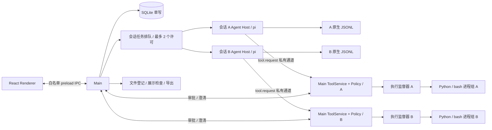

# 数据分析客户端：技术设计与验证

更新日期：2026-11-07。产品范围以 [产品说明](mvp-plan.md) 为准，交付阶段见 [开发计划](development-plan.md)。本文是唯一技术决策入口；原 architecture.md 仅保留跳转。`validation/` 中是可重跑的技术验证，不是已经完成的产品代码。

## 1. 技术栈与运行边界

本产品是支持数据分析工作的通用 AI 工作台。应用管理执行、交互、文件与状态；CSV 解析、分析代码、业务口径和结论由 Agent 负责，不实现业务结果验证器或运行时 Judge。

采用单仓库、单 pnpm package 的 TypeScript Electron 应用。React + shadcn/ui + Tailwind + Zustand/reducer；流式 Markdown 使用 Streamdown；pi coding-agent SDK 直接运行于 utilityProcess；Main 使用 better-sqlite3 单写；Python/pandas/NumPy/Matplotlib/Seaborn、字体及通用搜索二进制随包提供。通用工具保持 read/write/edit/bash/grep/find/ls/ask_clarification。

electron-vite 构建 main/agent 两个 Node 入口，以及 preload/renderer；electron-builder 生成本机 `.app`。Python 可执行文件、标准库、扩展和字体放入真实资源目录，不塞进 ASAR。产品不要求用户安装 Node、Python、pip 或 Homebrew。

Renderer 保持 `nodeIntegration: false`、`contextIsolation: true` 与 sandboxed preload，只暴露有类型和参数校验的 IPC 能力。“不使用沙箱”指 Agent 工具执行策略，不意味着关闭 Electron 的渲染进程安全隔离。

运行目标：本机 macOS 15.7.4 / Apple M4 / arm64 / 24 GiB。首版本地 `.app` 验收不要求签名公证、Intel 或历史 macOS 兼容；不将未测平台标为支持。

已实测基线为 Electron 45.2.3（内嵌 Node 24.22.2）、pi 1.5.0、better-sqlite3 13.0.3、Streamdown 2.7.1、standalone CPython 3.12.12；正式工程从该基线开始锁定。完整依赖版本、实际命令、原始结果由 [验证入口与证据说明](../validation/README.md) 和各探针 lockfile 固定。源码依据为本地 pi commit `f9a26365568127461c47a07a37dcb42c140a3ac5`，探针使用的发布包版本须单独记录，不把 checkout 等同于 npm 发布物。

## 2. 进程、并发与职责



### Main

- SessionService：会话、workspace、原始 CSV 路径引用、删除/归档与恢复。
- RunAdmission：最多两个活跃会话的 FIFO 排队。等待审批/澄清仍占本会话许可；不是第三套模型轮次调度。取消排队任务不启动 Host；启动失败释放许可。
- AgentSupervisor：每个活跃会话独立 Host、消息路由、生命周期、恢复和故障处理。其他会话浏览使用只读历史，不额外持有 JSONL 写者。
- StateRepository：SQLite 唯一写入口，migration、短事务、外键、WAL、busy timeout。
- InteractionBroker：按 sessionId/runId/toolCallId 绑定审批与澄清；关闭窗口不取消，Cmd+Q/停止/崩溃取消。
- CredentialService：BYOK 加密持久化，只发送当前模型凭证到对应 Host；Renderer 不接收已保存的明文 key。
- FileReferenceService：获取所选文件路径，检查真实路径、存在性、大小和合计大小。不读取 CSV 内容、不解析、不生成数据预览；不复制源文件、不监测外部替换、不维护数据版本。
- ArtifactService：登记候选文件、分配/核对 artifact 身份，检查访问权限和展示条件，提供受控读取与导出；文件监听只提示重扫。不检查报告数值、关联键或分析结论。

### Agent Host

一个 Host 对应一个活跃会话，持有 createAgentSession、SessionManager、受控 ResourceLoader、工具代理与当前执行投影。工具代理通过私有端口发送经过 schema 校验的 tool.request；实际文件访问、PolicyService、InteractionBroker 和 ProcessRunner 在 Main 执行。Main 从当前任务绑定 session/run/epoch/workspace/Host PID，不接受模型伪造这些上下文。Host 不直接写 SQLite。停止 A 只终止 A 的进程、审批和输入队列，不触碰 B。

pi 负责会话内部的 prompt/steer/followUp、重试和压缩；应用只做输入身份关联与外部会话准入。普通输入在空闲时开始新 run；执行中的 steer/follow-up 属同一 run、不同 inputId。全局排队任务重启后不自动恢复执行，保留为未发送。

### 执行监督器

不能依赖 Host 自己的 finally 回收所有子进程。执行监督器负责持有工具进程组，监视 Main/Host 存活，并在正常取消或父进程消失时 TERM，超时后 KILL。精确采用已运行探针验证的方式，记录 PID/进程身份，避免对复用 PID 误杀。

正常受控脚本及其同组子进程必须回收；不宣称能回收任意主动 setsid/逃逸进程组的恶意程序。执行监督器是生命周期机制，不是文件访问沙箱。

## 3. 源码目录与依赖方向

```text
data_agent/
  package.json / pnpm-lock.yaml
  electron.vite.config.ts / electron-builder.yml
  src/
    main/
      index.ts / application.ts
      ipc/handlers.ts
      services/                 # sessions, admission, supervisor, interactions,
                                # credentials, file-references, artifacts
      storage/database.ts
      storage/repositories.ts
      storage/migrations/*.sql
      artifact-protocol.ts
    preload/index.ts
    agent/
      index.ts / session-runtime.ts
      input-identity.ts / event-adapter.ts / history.ts
      model-runtime.ts / resource-loader.ts
      tools/ / tool-client.ts
    renderer/
      app/ / components/ui/ / state/ / styles/
      features/                 # sessions, chat, execution, inputs, artifacts,
                                # interactions, settings
    shared/contracts/           # Zod schemas + 可序列化命令/事件 DTO
    shared/models.ts / errors.ts
    node/                       # app-paths, resource-paths, logging, process-runner
  resources/
    skills/<name>/SKILL.md
    python/                     # 执行监督器等可信固定脚本，不含 CSV 预览/解析服务
    runtime-lock.json / requirements.hashed.lock
  runtime/darwin-arm64/          # 固定版本构建资源，生成物不提交
  scripts/build/ / scripts/test/
  tests/unit/ / integration/ / e2e/ / fixtures/ / phases/
  evaluations/fixtures/ / rubrics/ / results/  # 独立 Judge 效果评测，不接产品运行时
  validation/                   # 本次已执行的独立技术验证，不作为产品运行入口
  test-results/ / out/ / release/
  docs/mvp-plan.md / technical-design.md / development-plan.md
```

Renderer 只依赖 shared/UI；preload 只提供窄 IPC；Main 与 Agent Host 通过 shared contracts 通信，不能互相 import 实现；shared 不依赖 Node/Electron/pi；node 是可复用基础设施。TypeScript 不能替代 IPC 运行时校验。依赖方向用 lint 检查。

P2 的具体实现将准入/进程路由放在 `main/services/runtime.ts`，进程传输放在 `agent-process.ts`，凭证在 `credentials.ts`；Host 使用 `agent/session-runtime.ts`、`input-identity.ts`、`event-adapter.ts`、`models.ts` 和固定 `resource-loader.ts`。Renderer 的 `features/runtime/` 提供快照订阅、模型设置和 Streamdown 过程展示。SQLite migrations 当前集中在 `storage/database.ts`，无需为小型初始 schema 拆出空模块；以上目录树同时列出了后续阶段的职责位置。

P3 的通用工具由 `main/services/tools.ts` 统一执行；`policy.ts` 与可信 `resources/python/inspect_policy.py` 做非执行式检查，`interactions.ts` 负责一次性授权和澄清。Host 的 `tool-client.ts` 只传输工具请求/输出/交互，`tool.interaction` 进入 Host 快照后沿同一 seq 通道更新 UI，避免 Main/Host 各自递增状态序号。取消先由 Host 标记 SDK 中止，再等待 Main 的实际工具进程清理；普通用户停止不误报为模型失败。

`pnpm runtime:prepare` 从已校验缓存准备资源；干净机器显式运行 `pnpm runtime:prepare -- --download` 获取锁定资源，构建机需要 uv。脚本锁定 Python/rg/fd/字体哈希和 Python wheel 哈希，并生成完整运行时清单。`pnpm runtime:verify` 校验版本、每个文件哈希和符号链接；打包将运行时与辅助脚本放入 `Contents/Resources/runtime` 和 `Contents/Resources/python`，不依赖开发机 PATH 或 ASAR 内可执行路径。工具环境只含固定 PATH、工作区 HOME/cache/tmp 和受信字体配置，不继承模型 key。运行中的应用不下载或安装依赖。

## 4. 输入路径、存储和删除

业务状态默认位于 `~/.data_agent/`，测试用独立 `DATA_AGENT_HOME`。自选 workspace 和原始 CSV 路径是全局目录之外的合法引用。Electron userData 与业务数据根分离；测试同时隔离两者。

```text
~/.data_agent/
  state.sqlite
  sessions/{appSessionId}.jsonl
  workspace/{appSessionId}/
    runs/{runId}/versions/{versionId}/
      analysis.py / report.md     # Agent 按任务生成的示例文件，并非强制清单
      figures/*.png / tables/*.csv
    .cache/ / .tmp/
  logs/
# CSV 仍位于用户选择的原路径，不在这里另建 inputs 副本。
```

SQLite 管理会话、文件引用、运行及交互元数据。已实现 `sessions`、`file_refs`、`runs`、`run_inputs`、`interactions`、`output_versions`、`artifacts`、`app_metadata`、`schema_migrations`；`run_inputs` 只存 inputId/kind/state/native entryId，不存聊天正文。`app_metadata` 存所选模型和 safeStorage 加密后的 provider key，明文不回传 Renderer。后续阶段增加 `run_files`（当次选用路径/大小）、未发送草稿；不另建聊天正文表。`file_refs`/`run_files` 都不是 CSV 版本库，不代表冻结文件内容，用户数据替换不进入应用版本管理。

添加/提交任务时校验所选 CSV 合计 ≤100,000,000 bytes；排队到实际启动时复核存在性与大小。关联生成的中间表不算原始 CSV 上传总量，但受执行资源/输出限额约束。路径不是权限令牌，仍走 PolicyService。

JSONL 是消息唯一事实源，SQLite 不另建永久完整聊天表。SessionManager 是唯一 JSONL 写者；Main 是唯一 SQLite 写者；二者没有跨介质原子事务。状态使用 creating/draft/persisted/missing 等，启动对账，不把 `message_end` 当落盘 ACK。

`appSessionId` 与 pi header ID 分开；用 `SessionManager.open(exactFile, sessionsDir, cwd)` 保持精确文件布局。草稿没有 JSONL 是正常状态；已有历史却缺失/零字节/损坏时不能静默新建。先只读预检和备份，再使用可能迁移文件的 SDK API。

删除会话只清理明确登记的应用自有文件，原始 CSV、自选父目录、用户手动放入且未登记的文件保留。部分失败保留清理记录；外部 workspace 不可用时显示异常，不自动换新目录。读取不存在的源 CSV 正常报错，不实现外部变更恢复功能。

## 5. 命令、事件与运行状态

IPC 命令携带 requestId/sessionId；输入另带 inputId。当前 Host 通过 `runtime.event` 发送白名单 `snapshot` 对象，包含 schemaVersion/sessionId/runId/hostEpoch/seq 与完整可序列化投影；控制命令另有按请求 ID 关联的响应。每个 Host 独立 epoch/seq，不能把 A 的快照或 B 的迟到事件应用到另一个会话。

- `message_update` 的 text_delta/thinking_delta/toolcall_* 驱动正文与准备调用。
- `tool_execution_start/update/end` 驱动工具状态，用 toolCallId 关联。
- `message_end` 用最终消息校准 UI；持久化确认需另外取得。
- `queue_update` 辅助显示 SDK 队列，不作为输入身份事实源。
- retry/compaction 显示状态；`agent_end` 不一律代表最终完成。
- `agent_settled` 表示已经启动的持续执行收束；prompt/preflight rejection 也必须单独处理。

运行状态：queued → starting → running / waiting_approval / waiting_input → cancelling 或终态 completed/failed/cancelled/interrupted。run 启动失败或最终终态时释放会话准入许可；单工具失败或审批拒绝只结束该工具/交互，SDK 继续时不能释放许可。执行状态以 SDK/进程的实际生命周期为准，不以自然语言声明推断，也不据此判定分析正确。

运行终态与文件展示状态分开：`runs.state` / `RuntimeSnapshot.state` 记录 SDK/进程是否完成；P4 的 `ArtifactRecord.state` 使用 ready/empty/too_large/invalid/changed/missing 描述文件访问和展示条件（类型还预留 unsupported）。输出版本状态为 open/published，登记错误另存 error。ready 不表示内容正确，普通文件仍可能需要导出后用其他应用打开；缺失报告也不改写已结束的 SDK 状态。UI 使用“执行完成”“已生成报告”“文件不存在/无法展示”，不设置表示分析正确性的状态。普通聊天允许没有产物；测试可约定必须生成某个非空文件。

Host 内保留可序列化的活动投影；快照 = 当前分支持久化历史 + 活动 partial/tool/interaction/queue + seq 水位。Renderer 重载恢复该快照，再补后续事件；Host 崩溃不承诺恢复尚未落盘的每个 token。

SDK partial 是可变对象，订阅回调立即复制所需字段；以约 30–60 ms 合并 UI 更新，有界日志和结果，避免逐 token 写 SQLite。模型请求在 Host，不把 Renderer Network 面板当模型请求证据。

## 6. pi 输入身份与恢复

SDK 原生 steer/followUp 没有应用 inputId 参数；同文本消息不能靠正文或 queue_update 字符串去重。必须采用已实测的身份桥接方案，保留 SDK 原生树格式，通过 SDK 公共入口写元信息；不能给 SDK 私有字段打补丁或另建聊天正文事实源。

已运行的方案是应用给每条用户输入添加唯一外层 envelope，由可信 context hook 在模型请求前只剥除最外层，Renderer 同样还原原文；JSONL 保留标准 message/custom entry。SessionManager 的 custom entry 记录 submitted 与 committed(inputId→entryId)，不复制正文。用户自己写的类似标记仍保留为原文，不作为控制信息。

在 turn_end/agent_settled 或命令最终收束后读取实际 JSONL record 确认映射；恢复先加载已有 committed，再幂等补缺失映射，不反复 append 同一 ACK。应用生成 UUID 并校验登记表，只信应用外层标记。本次确认是完整 record 可读，不声称 fsync 级断电耐久性。具体格式、上下文处理、相同文本与恢复结果见 [验证入口与证据说明](../validation/README.md)。应用自带的可信身份 hook 可以显式加载；关闭的是宿主/用户的自动资源发现，不是禁止应用自带适配代码。

确认持久化后才把 input 标 committed；未知结果标 unknown，不能自动重放。abort 后显式清 SDK 队列，未消费输入保留未发送。同一文本的两次用户输入仍是两个 inputId。

## 7. 通用工具、资源和模型

tools 使用明确名称白名单，customTools 提供受控实现；`tools: []` 不能作为“只关 builtin”的写法。串行工具配置作用于每个会话，两会话间可并发。大文件 read 先检查大小，不能复用“读全文后截断”处理 100 MB；通过普通 bash 与内置 Python 做有界抽样。

ResourceLoader 只返回固定 skills/system prompt 和应用自带 hooks；SettingsManager、模型配置、agentDir、session 文件均显式指定，避免读取 workspace/global `.pi` 的任意扩展与配置。分析 skills 指导 Agent 自主写脚本，而不是把业务步骤固定为工具 API。

模型 UI 使用 pi 可用的 API-key provider/model 清单，展示能力与验证状态；不伪称每个模型都支持 thinking、视觉或所有工具行为。非视觉模型不发送不支持的 image content；PNG 照样由产品展示。模型与 key 以 run 配置确定，不在运行中切换。

本地真实测试固定：

| 配置 | 值 |
| --- | --- |
| 显示名称 | DeepSeek-V41-Flash |
| provider / model | deepseek / deepseek-flash |
| base URL | https://api.deepseek.com |
| key 来源 | `~/.zshrc` 中的 `DEEPSEEK_API_KEY` |
| 思考配置 | enabled / high，由实际 SDK 请求验证 |

`deepseek-flash` 为服务端可更新别名，记录请求/响应模型和日期；thinking+tools 后续请求由 SDK 保留 reasoning_content，不从 UI 重建。[DeepSeek 官方](https://api-docs.deepseek.com/)、[thinking/tools](https://api-docs.deepseek.com/guides/thinking_mode/)

产品不执行用户 `.zshrc`；本地测试启动器单独获取该变量，不打印环境集合。Main/Host 私有通道传凭证；工具执行环境为白名单，无 key。生产 BYOK 用 safeStorage 加密，不把 key 保存到 JSONL/报告。

## 8. PolicyService 与审批

统一入口先做 schema、真实路径和命令/脚本检查，再 allow/ask/deny。文件路径使用 realpath/最近现存父目录，按目录归属判断，不用字符串前缀。源/目标均检查；执行前复核解析路径和脚本摘要，仍不声称消除所有竞态。

| 规则 | 决定 |
| --- | --- |
| 普通外部读、正常内部读 | allow |
| 普通 workspace 内新文件写入 | allow |
| 已声明源 CSV 的可识别修改 | ask，即使源文件恰好位于 workspace 内也不默写；默认分析写新产物 |
| 已发布产物的可识别修改 | deny；产物修改请求写新版本 |
| state/sessions/凭证配置、敏感路径 | deny 读写 |
| 检测到 workspace 外写删 | ask |
| 已识别 curl/wget/requests/httpx 等联网 | ask；说明可识别的目标和动作 |
| 明确破坏系统、安装依赖/修改内置运行时 | deny |
| 可识别动态执行、无法解析的写入目标 | ask |
| 检查器异常 | deny/error，不静默放行 |

敏感路径基线覆盖应用凭证/控制文件、用户 SSH/云凭证、shell 启动文件及 `.env` 等显式凭证文件；在规则版本和样例表中列出具体模式。外部读取默认允许不等于允许读取这些文件。模型 API 为应用已配置行为，不通过工具联网审批反复询问。

静态 shell cd 追踪后续命令的目录，外部只读检查照常允许；未解析的目录变化仍需确认。脚本分析不执行导入；对常见 open/Path/to_csv/savefig/delete 等识别路径，正常可解析输出避免误报；未知代码不能被宣称已完整分析。正则与有界语法分析只能提供尽力检测，任意导入、别名、原生库、动态网络和进程组逃逸不属于可保证覆盖。

审批凭据绑定 session/run/toolCall/hostEpoch、参数、脚本 hash、规范路径、网络摘要及规则版本，原子消费一次；修改、停止、崩溃、Cmd+Q 后无效。关窗口保留等待。恶意文件内容不产生用户批准，不允许将工具输出当授权来源。

实际的路径/审批与分类器探针见 [policy/probe.py](../validation/policy/probe.py)；探针是有限规则机制证明，不是完整生产规则集合。

## 9. 通用产物管理与 UI 展示

应用分配 run/version 输出位置；P4 为每个 run 分配一个版本，P5 补充同一持续执行 run 内 follow-up 的版本切换。Main 在输出位置扫描候选文件并登记到 SQLite artifacts，身份、归属、真实路径、文件类型、尺寸和 hash 由 Main 获取。版本 ID 或 artifact ID 冲突拒绝登记；模型自报的文件路径仍须检查。

P4 的 `ArtifactService` 在 SDK 任务终态后扫描应用分配的输出目录；只登记普通文件，跳过隐藏文件与符号链接。每版最多 1,000 个文件、5,000 个扫描条目、500 MiB；报告预览最多 2 MiB，超限仍可导出。PNG 在大小/像素检查后交给 Electron 实际解码。空文件或损坏图片保留登记并标明无法展示，不将其状态当成任务执行或分析正确性结论。应用退出先等待已开始的目录分配/登记再关闭 SQLite，重启扫描未发布版本以保留已生成文件。

Renderer 只请求 sessionId/artifactId，由 Main 再核对版本目录、真实路径、大小和 SHA256；预览不接受任意磁盘路径。Markdown 的相对图片只映射同版本已登记 PNG，外部图片不加载；外链只能经用户点击和 Main HTTP/HTTPS 校验后打开。整版导出保持相对目录结构，不拷贝原 CSV；已登记文件发生变化时拒绝冒充旧版本读取或导出。

不要求 Agent 生成 metrics.json、manifest.json、metric 标记或特定业务 schema，也不交叉核对报告、表格和图表的数值。应用自己的产物索引只保存文件元数据；即使 Agent 自行生成同名 JSON，它也只是普通产物，不成为权威状态来源。

文件存在、非空、路径权限、类型/尺寸上限、图片解码、Markdown 安全渲染属于工作台检查。语义正确性（包括金额是否重复放大、图表是否与计算一致）归独立 LLM-as-a-judge 评测，不在产物登记或展示前运行。非空 report.md 可以满足测试的文件交付断言，即使 Judge 随后认为其结论错误。

已发布产物登记 hash；受控工具拒绝识别出的覆盖，更新生成新版本。外部用户修改文件不受应用隔离，读取时若发现已登记产物不一致，标为“文件已变更”，不能继续冒充原始发布版本。此规则针对应用产物，不引入 CSV 版本管理。

Markdown 禁止 raw HTML，保留 sanitize；远程图片默认不自动加载。相对图片由受控 artifact ID 映射真实文件，不允许任意 file URL；外链显式打开。Streamdown 的真实渲染验证范围在验证记录说明，不把静态字符串检查冒充 UI 验证。

## 10. 执行限额与可观察性

初始产品默认值：单工具执行 180 秒；单 run 活跃执行时间 10 分钟、最多 20 次模型请求；HTTP 暂时性失败最多重试 2 次且计入限额。工作台不判定业务错误或统计“业务自修复次数”；Agent 可在总预算内自行修复代码或解释无法完成的原因。等待用户审批/澄清不计活跃执行计时，但继续占会话名额，可显式停止。截断日志不截断错误状态。

工具单次 UI 文本最多 64 KiB，完整轮转日志每 run 最多 10 MiB；单 PNG 最大 25 MiB/40 百万像素，超限不给 Renderer 解码。生成数据可超过输入体积但需按输出限额及时终止；初始 run 产物目录上限 500 MiB。超限返回明确错误，保留已完成产物状态，不偷偷改用其他模型或无界重试。

100 MB / 180 秒 / Python 进程树峰值 RSS 2 GiB 是代表数据的基准目标，不是任意 CSV 形态的保证。基准必须固定字段分布、任务、计时范围和采样方法；并发两个任务另记录总资源。CSV 输入大小不能限制 join 中间结果大小，运行时需监测并明确失败。实际基准数据与已测数值见验证记录。

结构化日志含 session/run/tool/input/epoch，避免跨会话串联；脱敏 key/header，保留有限错误、退出码、耗时、版本与 artifact hash。指标和审批信息不是 assistant 正文，不伪造为 thinking。

## 11. 测试与证据的解释

- 程序/规则化验证负责 SDK 接入、真实模型调用链、Electron/CDP、SQLite/打包、内置 Python、文件交付、审批机制与进程回收；不校验分析数值或结论。确定性模型响应覆盖状态和错误分支，live 用例验证真实调用与文件交付。
- 正式产品开发把这些已验证的机制接入真实界面与生命周期，再运行产品 CDP/E2E。探针通过不是宣称所有 UI 或产品功能已完成。
- 主 E2E 保留真实 Electron/Main/pi/工具/Python/SQLite/JSONL，只可替换外部 LLM 响应做确定性故障回归；真实 DeepSeek 路径另测。
- P3 确定性 CDP 用本机 HTTP/SSE 模型夹具，保留真实 pi SDK 与全部副作用链路。仅 `--data-agent-automation` 可接收 `DATA_AGENT_TEST_MODEL_BASE_URL`，Host 再校验其必须为 `http://127.0.0.1`；普通启动忽略该变量。关闭/重开、退出、查询任务 Host PID 的自动化 IPC 同样只在显式测试模式注册处理，不能授予工具权限。
- 使用独立 userData、业务根、workspace、端口。CDP 仅显式测试模式、loopback，正常启动关闭；真实密钥不进入 Renderer。
- `connectOverCDP` 能力低于 Playwright 原生协议；本项目以实际连通/操作/截图结果为依据，不承诺所有高级功能。[Playwright](https://playwright.dev/docs/api/class-browsertype#browser-type-connect-over-cdp)
- 离线资源测试必须证明外部连接失败仍能运行分析；临时测试环境的网络限制不成为产品执行安全策略，不把只拦 Chromium 请求当作阻断 Python/Node。
- LLM-as-a-judge 单独读取任务、输入数据、执行记录和产物，评价 Agent 的方法、数据处理、结论依据与解释；当前由开发协作中的 AI Agent 执行，允许独立计算辅助判断。评测分数不写入产品完成状态，也不阻塞文件展示。
- 旧探针中的 oracle/业务 schema/报告数值断言仅保留为历史实验，不迁移为工作台逻辑或程序验收门禁；已有通过记录也不能冒充已完成 Judge 评测。

本次各项最终状态、命令与限制统一见 [验证入口与证据说明](../validation/README.md)。程序验收和独立 Judge 评测步骤见 [开发计划](development-plan.md)。
