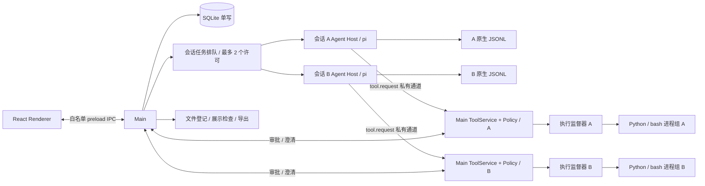

# 数据分析客户端：技术设计与验证

更新日期：2026-11-07。产品范围以 [产品说明](mvp-plan.md) 为准，交付阶段见 [开发计划](development-plan.md)。本文是唯一技术决策入口；原 architecture.md 仅保留跳转。`validation/` 中是可重跑的技术验证，不是已经完成的产品代码。

后续 UI 改动遵循 [设计原则](design-principles.md)；交付后的体验修复及草稿/附件状态调整见 [UX 修复计划](ux-remediation-plan.md)，UX1–UX4 与 R1–R5 已实施，完整回归证据见实施进度；下文描述实际结构与契约。

## 1. 技术栈与运行边界

本产品是支持数据分析工作的通用 AI 工作台。应用管理执行、交互、文件与状态；CSV 解析、分析代码、业务口径和结论由 Agent 负责，不实现业务结果验证器或运行时 Judge。

采用单仓库、单 pnpm package 的 TypeScript Electron 应用。React + shadcn/ui + Tailwind，界面状态使用 React hooks，运行快照按身份/序号合并；流式 Markdown 使用 Streamdown；pi coding-agent SDK 直接运行于 utilityProcess；Main 使用 better-sqlite3 单写；Python/pandas/NumPy/Matplotlib/Seaborn、字体及通用搜索二进制随包提供。通用工具保持 read/write/edit/bash/grep/find/ls/ask_clarification。

electron-vite 构建 main/agent 两个 Node 入口，以及 preload/renderer；electron-builder 生成本机 `.app`。Python 可执行文件、标准库、扩展和字体放入真实资源目录，不塞进 ASAR。产品不要求用户安装 Node、Python、pip 或 Homebrew。

Renderer 保持 `nodeIntegration: false`、`contextIsolation: true` 与 sandboxed preload，只暴露有类型和参数校验的 IPC 能力。“不使用沙箱”指 Agent 工具执行策略，不意味着关闭 Electron 的渲染进程安全隔离。

运行目标：本机 macOS 15.7.4 / Apple M4 / arm64 / 24 GiB。首版本地 `.app` 验收不要求签名公证、Intel 或历史 macOS 兼容；不将未测平台标为支持。

已实测基线为 Electron 45.2.3（内嵌 Node 24.22.2）、pi 1.5.0、better-sqlite3 13.0.3、Streamdown 2.7.1、standalone CPython 3.12.12；正式工程从该基线开始锁定。完整依赖版本、实际命令、原始结果由 [验证入口与证据说明](../validation/README.md) 和各探针 lockfile 固定。源码依据为本地 pi commit `f9a26365568127461c47a07a37dcb42c140a3ac5`，探针使用的发布包版本须单独记录，不把 checkout 等同于 npm 发布物。

## 2. 进程、并发与职责



### Main

- SessionService：会话、workspace、原始 CSV 路径引用、删除/归档与恢复。
- RunAdmission：最多两个活跃会话的 FIFO 排队。等待审批/澄清仍占本会话许可；不是第三套模型轮次调度。取消排队任务不启动 Host；启动失败释放许可。
- RuntimeService / AgentProcess：每个活跃会话独立 Host、消息路由、生命周期、恢复和故障处理。其他会话浏览使用只读历史，不额外持有 JSONL 写者。
- storage/database.ts：SQLite 连接与 migration、外键、WAL、busy timeout；Main 服务单写，RunLedger 拥有输入账本的短事务。
- InteractionBroker：按 sessionId/runId/toolCallId 绑定审批与澄清；关闭窗口不取消，Cmd+Q/停止/崩溃取消。
- CredentialService：BYOK 加密持久化，只发送当前模型凭证到对应 Host；Renderer 不接收已保存的明文 key。
- file-selection.ts / SessionService：获取所选文件路径，检查真实路径、存在性、大小和合计大小。导入时不读取 CSV 内容、不解析、不生成表格预览；不复制源文件、不监测外部替换、不维护数据版本。
- ArtifactService：登记候选文件、分配/核对 artifact 身份，检查访问权限和展示条件，提供受控读取与导出；在任务收束时扫描登记本轮文件。不检查报告数值、关联键或分析结论。

### Agent Host

一个 Host 对应一个活跃会话，持有 createAgentSession、SessionManager、受控 ResourceLoader、工具代理与当前执行投影。工具代理通过私有端口发送经过 schema 校验的 tool.request；实际文件访问、PolicyService、InteractionBroker 和 ProcessRunner 在 Main 执行。Main 从当前任务绑定 session/run/epoch/workspace/Host PID，不接受模型伪造这些上下文。Host 不直接写 SQLite。停止 A 只终止 A 的进程、审批和输入队列，不触碰 B。

pi 负责会话内部的 prompt/steer/followUp、重试和压缩；应用只做输入身份关联与外部会话准入。普通输入在空闲时开始新 run；执行中的 steer/follow-up 属同一 run、不同 inputId。全局排队任务重启后不自动恢复执行，保留为未发送。

### 执行监督器

不能依赖 Host 自己的 finally 回收所有子进程。执行监督器负责持有工具进程组，监视 Main/Host 存活，并在正常取消或父进程消失时 TERM，超时后 KILL。精确采用已运行探针验证的方式，记录 PID/进程身份，避免对复用 PID 误杀。

正常受控脚本及其同组子进程必须回收；不宣称能回收任意主动 setsid/逃逸进程组的恶意程序。执行监督器是生命周期机制，不是文件访问沙箱。

## 3. 源码目录与依赖方向

```text
data_agent/
  package.json / pnpm-lock.yaml
  electron.vite.config.ts / electron-builder.yml
  src/
    main/
      index.ts                  # 启动、单实例、窗口和退出生命周期
      ipc/handlers.ts / commands.ts / dependencies.ts
      services/                 # sessions, runtime, agent-process, interactions,
                                # credentials, file-picker, artifacts, tools,
                                # policy, deletion, logs
      services/runtime/         # admission、run-ledger、lifecycle
      services/artifacts-io.ts / tool-operations.ts
      storage/database.ts       # schema、migration 和 SQLite 连接
    preload/index.ts
    agent/
      index.ts / session-runtime.ts
      input-identity.ts / event-adapter.ts / history.ts
      models.ts / resource-loader.ts / redact.ts
      tools/ / tool-client.ts
      runtime-context.ts / request-budget.ts / request-evidence.ts
    renderer/
      app/ / components/ui/ / lib/ / styles/
      features/                 # sessions、composer、models、runtime、artifacts；各自拥有状态
    shared/contracts/           # Zod schemas + 可序列化命令/事件 DTO
    shared/models.ts / errors.ts
    node/                       # app-paths, runtime-paths, path-policy, read-text,
                                # output-budget, process-runner, session-integrity
  resources/
    skills/<name>/SKILL.md
    python/                     # 执行监督器等可信固定脚本，不含 CSV 预览/解析服务
    runtime-lock.json / requirements.hashed.lock
  runtime/darwin-arm64/          # 固定版本构建资源，生成物不提交
  scripts/build/ / scripts/test/ / scripts/eval/
  tests/features/ / support/ / fixtures/ / tooling/     # 按功能维护，catalog.json 注册；phases 仅历史留档
  evaluations/fixtures/ / rubrics/ / results/  # 独立 Judge 效果评测，不接产品运行时
  validation/                   # 本次已执行的独立技术验证，不作为产品运行入口
  test-results/ / out/ / release/
  docs/mvp-plan.md / technical-design.md / development-plan.md
```

Renderer 只依赖 shared/UI；preload 只提供窄 IPC；Main 与 Agent Host 通过 shared contracts 通信，不能互相 import 实现；shared 不依赖 Node/Electron/pi；node 是可复用基础设施。TypeScript 不能替代 IPC 运行时校验。Main 仅信任当前窗口的主框架，完整 URL 必须匹配；预期 URL 先用 WHATWG URL 规范化，兼容 Vite 的无末尾斜杠地址与 Chromium 的标准形式，不放宽为同源匹配。依赖方向用 lint 检查。

具体实现将准入/进程路由放在 `main/services/runtime.ts`，进程传输放在 `agent-process.ts`，凭证在 `credentials.ts`；Host 使用 `agent/session-runtime.ts`、`input-identity.ts`、`event-adapter.ts`、`models.ts` 和固定 `resource-loader.ts`。Renderer 的 `features/runtime/` 提供快照订阅与 Streamdown 过程展示；`features/composer/` 拥有草稿，`features/models/` 拥有模型设置。SQLite migrations 集中在 `storage/database.ts`；上面的目录树对应实际工程，没有为规划职责额外创建空模块。

P3 的通用工具由 `main/services/tools.ts` 统一执行；`policy.ts` 与可信 `resources/python/inspect_policy.py` 做非执行式检查，`interactions.ts` 负责一次性授权和澄清。Host 的 `tool-client.ts` 只传输工具请求/输出/交互，`tool.interaction` 进入 Host 快照后沿同一 seq 通道更新 UI，避免 Main/Host 各自递增状态序号。取消先由 Host 标记 SDK 中止，再等待 Main 的实际工具进程清理；普通用户停止不误报为模型失败。

`pnpm runtime:prepare` 从已校验缓存准备资源；干净机器显式运行 `pnpm runtime:prepare -- --download` 获取锁定资源，构建机需要 uv。脚本锁定 Python/rg/fd/字体哈希和 Python wheel 哈希，并生成完整运行时清单。`pnpm runtime:verify` 校验版本、每个文件哈希和符号链接；打包将运行时与辅助脚本放入 `Contents/Resources/runtime` 和 `Contents/Resources/python`，不依赖开发机 PATH 或 ASAR 内可执行路径。工具环境只含固定 PATH、工作区 HOME/cache/tmp 和受信字体配置，不继承模型 key。运行中的应用不下载或安装依赖。

## 4. 输入路径、存储和删除

业务状态默认位于 `~/.data_agent/`，测试用独立 `DATA_AGENT_HOME`。自选 workspace 和原始 CSV 路径是全局目录之外的合法引用。Electron userData 与业务数据根分离；测试同时隔离两者。

```text
~/.data_agent/
  state.sqlite
  sessions/{appSessionId}.jsonl
  workspace/{appSessionId}/
    analysis.py / report.md     # Agent 按任务生成的示例文件，并非强制清单
    figures/*.png / tables/*.csv
    .cache/ / .tmp/
  logs/
# CSV 仍位于用户选择的原路径，不在这里另建 inputs 副本。
```

SQLite 管理会话、文件引用、运行及交互元数据。已实现 `sessions`、`file_refs`、`runs`、`run_inputs`、`input_drafts`、`run_files`、`tool_logs`、`deletion_jobs`、`deletion_files`、`interactions`、`output_versions`、`artifacts`、`submission_receipts`、`conversation_intents`、`app_metadata`、`schema_migrations`；`run_inputs` 只存 inputId/kind/state/native entryId，不存聊天正文。`app_metadata` 存所选模型和 safeStorage 加密后的 provider key，明文不回传 Renderer。`input_drafts` 仅暂存已提交但尚未确认进入 JSONL 的输入文字和路径，原生 record 确认后在同一 SQLite 事务中删除；未知/取消输入保留到用户显式移除。它不作为模型上下文或永久聊天事实源。`run_files` 记录提交时选用的路径/登记大小，`tool_logs` 只存工具输出文件索引、结束原因和进程树采样峰值 RSS；`deletion_jobs`/`deletion_files` 保留明确清理选择与每个路径的进度。仍不另建永久聊天正文表。`file_refs`/`run_files` 都不是 CSV 版本库，不代表冻结文件内容，用户数据替换不进入应用版本管理。

添加 CSV 时按文件元数据校验单文件及选用合计 ≤100,000,000 bytes；提交任务时检查原路径是否缺失，记录当时选用的路径和已登记大小。排队任务沿用提交时的引用；不冻结文件内容、不检测外部替换，也不按内容解析 CSV。实际读取失败由通用工具返回。关联生成的中间表不算原始 CSV 上传总量，但受执行资源/输出限额约束。路径不是权限令牌，仍走 PolicyService。

JSONL 是消息唯一事实源，SQLite 不另建永久完整聊天表。SessionManager 是唯一 JSONL 写者；Main 是唯一 SQLite 写者；二者没有跨介质原子事务。状态使用 creating/draft/persisted/missing 等，启动对账，不把 `message_end` 当落盘 ACK。

`appSessionId` 与 pi header ID 分开；用 `SessionManager.open(exactFile, sessionsDir, cwd)` 保持精确文件布局。草稿没有 JSONL 是正常状态；已有历史却缺失/零字节/损坏时不能静默新建。先只读预检和备份，再使用可能迁移文件的 SDK API。

删除会话先标记 deleting，停止本会话并等待 Host、工具进程和产物登记收束。默认仅清理原生会话记录和登记工具日志；用户显式勾选后才清理登记产物。原始 CSV（包括被另一会话引用的路径）、自选父目录、用户手动放入且未登记的文件保留。按普通文件、路径和登记 hash 校验后逐个删除，不递归清空 workspace；仅移除空的产物祖先目录。路径重定向或内容变更时保留文件和 SQLite 清理记录，重启后可继续，不能用重试修改最初的清理选择。部分失败保留清理记录；外部 workspace 不可用时显示异常，不自动换新目录。读取不存在的源 CSV 正常报错，不实现外部变更恢复功能。

## 5. 命令、事件与运行状态

IPC 命令携带 requestId/sessionId；输入另带 inputId。当前 Host 通过 `runtime.event` 发送白名单 `snapshot` 对象，包含 schemaVersion/sessionId/runId/hostEpoch/seq 与完整可序列化投影；控制命令另有按请求 ID 关联的响应。每个 Host 独立 epoch/seq，不能把 A 的快照或 B 的迟到事件应用到另一个会话。

- `message_update` 的 text_delta/thinking_delta/toolcall_* 驱动正文与准备调用。
- `tool_execution_start/update/end` 驱动工具状态，用 toolCallId 关联。
- `message_end` 用最终消息校准 UI；持久化确认需另外取得。
- `queue_update` 辅助显示 SDK 队列，不作为输入身份事实源。
- retry/compaction 显示状态；`agent_end` 不一律代表最终完成。
- `agent_settled` 表示已经启动的持续执行收束；prompt/preflight rejection 也必须单独处理。

运行状态：queued → starting → running / waiting_approval / waiting_input → 终态 completed/failed/cancelled/interrupted。取消过程中等待实际工具回收，不单独持久化 cancelling 状态。run 启动失败或最终终态时释放会话准入许可；单工具失败或审批拒绝只结束该工具/交互，SDK 继续时不能释放许可。执行状态以 SDK/进程的实际生命周期为准，不以自然语言声明推断，也不据此判定分析正确。

运行终态与文件展示状态分开：`runs.state` / `RuntimeSnapshot.state` 记录 SDK/进程是否完成；P4 的 `ArtifactRecord.state` 使用 ready/empty/too_large/invalid/changed/missing 描述文件访问和展示条件（类型还预留 unsupported）。产物目录登记状态为 open/published，登记错误另存 error；兼容字段仍名为 output_versions/versionId，共享目录并不代表历史快照。ready 不表示内容正确，普通文件仍可能需要导出后用其他应用打开；缺失报告也不改写已结束的 SDK 状态。UI 使用“执行完成”“已生成报告”“文件不存在/无法展示”，不设置表示分析正确性的状态。普通聊天允许没有产物；测试可约定必须生成某个非空文件。

Host 内保留可序列化的活动投影；快照 = 当前分支持久化历史 + 活动 partial/tool/interaction/queue + seq 水位。Renderer 重载恢复该快照，再补后续事件；Host 崩溃不承诺恢复尚未落盘的每个 token。

SDK partial 是可变对象，订阅回调立即复制所需字段；以约 30–60 ms 合并 UI 更新，有界日志和结果，避免逐 token 写 SQLite。模型请求在 Host，不把 Renderer Network 面板当模型请求证据。

## 6. pi 输入身份与恢复

SDK 原生 steer/followUp 没有应用 inputId 参数；同文本消息不能靠正文或 queue_update 字符串去重。必须采用已实测的身份桥接方案，保留 SDK 原生树格式，通过 SDK 公共入口写元信息；不能给 SDK 私有字段打补丁或另建聊天正文事实源。

已运行的方案是应用给每条用户输入添加唯一外层 envelope，由可信 context hook 在模型请求前只剥除最外层，Renderer 同样还原原文；JSONL 保留标准 message/custom entry。SessionManager 的 custom entry 记录 submitted 与 committed(inputId→entryId)，不复制正文。用户自己写的类似标记仍保留为原文，不作为控制信息。

在 turn_end/agent_settled 或命令最终收束后读取实际 JSONL record 确认映射；恢复先加载已有 committed，再幂等补缺失映射，不反复 append 同一 ACK。应用生成 UUID 并校验登记表，只信应用外层标记。本次确认是完整 record 可读，不声称 fsync 级断电耐久性。具体格式、上下文处理、相同文本与恢复结果见 [验证入口与证据说明](../validation/README.md)。应用自带的可信身份 hook 可以显式加载；关闭的是宿主/用户的自动资源发现，不是禁止应用自带适配代码。

确认持久化后才把 input 标 committed；未知结果标 unknown，不能自动重放。abort 后显式清 SDK 队列，未消费输入保留未发送。同一文本的两次用户输入仍是两个 inputId。

Main 在接受输入时原子登记 run_inputs 与 input_drafts，再交给 Host；全局排队时同样保留文字。重启后只读原生历史对账 committed，清理已落盘草稿；剩余未知/取消输入通过 Main 的 unsentInputs 投影呈现，可放回输入框或显式移除，不自动重发。未发送输入跨后续 run 保留，移除按会话和 inputId 校验，不能删除活动队列中的输入。JSONL 仍为唯一永久会话内容。用户主动停止会清除暂时性模型错误，以 cancelled 收束；运行超时保留限额错误，以 failed 收束。

### 上下文稳定性与执行限制

不再注册逐请求追加动态 system 消息的 context_with_system hook。工具结果由 pi 正常追加；附件路径经 InputIdentity 随对应用户消息投影，后续恢复保持相同位置与表示。新会话固定 system prompt/cwd/工具声明/skill 声明，预算变化不进入上下文。请求上限通过 streamFunction 入口拦截第 21 次调用（含重试），活跃执行时间和工具超时由监督机制停止；仅 UI 显示限制错误。不依赖 SDK 扩展抛错来阻断，因为某些扩展错误会被 SDK 捕获后继续请求。

恢复旧会话时复用原生历史中的 system preamble/cwd，不能为升级改写已发送前缀。旧 cwd 为 run/version 目录的会话只追加一次原生隐藏 custom_message `data_agent.workspace_migration` 说明后续改用共享目录；保留原位置，重启不重复添加。这是迁移兼容，不是逐请求状态提示。新会话没有此消息。上下文压缩是唯一允许重建前缀的例外；当前提供方最终序列化请求的前缀由测试直接比较，不能仅检查中间消息数组。服务端缓存命中仍受提供方策略影响。

## 7. 通用工具、资源和模型

tools 使用明确名称白名单，customTools 提供受控实现；`tools: []` 不能作为“只关 builtin”的写法。串行工具配置作用于每个会话，两会话间可并发。大文件 read 先检查大小，不能复用“读全文后截断”处理 100 MB；通过普通 bash 与内置 Python 做有界抽样。

ResourceLoader 只返回固定 skills/system prompt 和应用自带 hooks；SettingsManager、模型配置、agentDir、session 文件均显式指定，避免读取 workspace/global `.pi` 的任意扩展与配置。分析 skills 指导 Agent 自主写脚本，而不是把业务步骤固定为工具 API。

模型 UI 使用 pi 可用的 API-key provider/model 清单，展示能力与验证状态；不伪称每个模型都支持 thinking、视觉或所有工具行为。非视觉模型不发送不支持的 image content；PNG 照样由产品展示。模型、Base URL、key 和思考级别在提交时绑定到 run，排队或运行期间更改设置只影响之后的新任务。可选思考级别直接取锁定 pi 版本的 `getSupportedThinkingLevels`，不支持思考的模型隐藏控件；每个模型独立保存选择。DeepSeek-V41-Flash 标明已验证基本流程，其余模型显示未验证兼容性；这不是分析正确性标识。

本地真实测试固定：

| 配置             | 值                                  |
| ---------------- | ----------------------------------- |
| 显示名称         | DeepSeek-V41-Flash                  |
| provider / model | deepseek / deepseek-flash           |
| base URL         | https://api.deepseek.com            |
| key 来源         | `~/.zshrc` 中的 `DEEPSEEK_API_KEY`  |
| 思考配置         | enabled / high，由实际 SDK 请求验证 |

`deepseek-flash` 为服务端可更新别名，记录请求/响应模型和日期；thinking+tools 后续请求由 SDK 保留 reasoning_content，不从 UI 重建。[DeepSeek 官方](https://api-docs.deepseek.com/)、[thinking/tools](https://api-docs.deepseek.com/guides/thinking_mode/)

产品不执行用户 `.zshrc`；本地测试启动器单独获取该变量，不打印环境集合。Main/Host 私有通道传凭证；工具执行环境为白名单，无 key。生产 BYOK 用 safeStorage 加密，不把 key 保存到 JSONL/报告。

## 8. PolicyService 与审批

统一入口先做 schema、真实路径和命令/脚本检查，再 allow/ask/deny。文件路径使用 realpath/最近现存父目录，按目录归属判断，不用字符串前缀。源/目标均检查；执行前复核解析路径和脚本摘要，仍不声称消除所有竞态。

| 规则                                   | 决定                                                           |
| -------------------------------------- | -------------------------------------------------------------- |
| 普通外部读、正常内部读                 | allow                                                          |
| 普通 workspace 内新文件写入            | allow                                                          |
| 已声明源 CSV 的可识别修改              | ask，即使源文件恰好位于 workspace 内也不默写；默认分析写新产物 |
| 旧版历史目录产物的可识别修改           | deny；会话共享目录的当前产物允许更新                           |
| state/sessions/凭证配置、敏感路径      | deny 读写                                                      |
| 检测到 workspace 外写删                | ask                                                            |
| 已识别 curl/wget/requests/httpx 等联网 | ask；说明可识别的目标和动作                                    |
| 明确破坏系统、安装依赖/修改内置运行时  | deny                                                           |
| 可识别动态执行、无法解析的写入目标     | ask                                                            |
| 检查器异常                             | deny/error，不静默放行                                         |

敏感路径基线覆盖应用凭证/控制文件、用户 SSH/云凭证、shell 启动文件及 `.env` 等显式凭证文件；在规则版本和样例表中列出具体模式。外部读取默认允许不等于允许读取这些文件。模型 API 为应用已配置行为，不通过工具联网审批反复询问。

静态 shell cd 追踪后续命令的目录，外部只读检查照常允许；未解析的目录变化仍需确认。脚本分析不执行导入；对常见 open/Path/to_csv/savefig/delete 等识别路径，正常可解析输出避免误报；未知代码不能被宣称已完整分析。正则与有界语法分析只能提供尽力检测，任意导入、别名、原生库、动态网络和进程组逃逸不属于可保证覆盖。

审批凭据绑定 session/run/toolCall/hostEpoch、参数、脚本 hash、规范路径、网络摘要及规则版本，原子消费一次；修改、停止、崩溃、Cmd+Q 后无效。关窗口保留等待。恶意文件内容不产生用户批准，不允许将工具输出当授权来源。

实际的路径/审批与分类器探针见 [policy/probe.py](../validation/policy/probe.py)；探针是有限规则机制证明，不是完整生产规则集合。

## 9. 通用产物管理与 UI 展示

同一 session 共用 SessionService 分配的 workspace。普通 prompt 创建新的运行账本，但不创建新产物目录；steer/follow-up 同样保持目录不变。system prompt 在新会话初始化时包含固定工作区、输出目录与默认工具 cwd。工具、审批和进程仍按 run 管理，不把产物目录和任务生命周期绑在一起。

`ArtifactService.openWorkspace` 复用 directory 等于 session.workspace 的唯一 output_versions 行，将 run_id 更新为当前任务并设为 open；该表名与 versionId 仅为兼容既有 SQLite/IPC，不再表示每轮文件快照。无需破坏性 schema 迁移。后续任务开始前等待上一任务停止写入和登记结束；启动时恢复 open 目录的登记，分配目录前等待同目录未完成扫描。任务结束后扫描工作区，按相对路径更新 size/hash/state，保留同路径 artifact ID；仅在完整扫描成功后移除已删除文件的登记。文件状态/哈希变化驱动预览重新读取，避免同 ID 下继续显示旧报告。

兼容策略：保留旧 output_versions/artifacts 行和原 runs/.../versions/... 文件，不搬移、不删除、不冒充当前快照。共享工作区扫描排除已登记旧版本目录及当前原 CSV 引用，隐藏文件/符号链接跳过；旧版本产物仍禁止可识别的覆盖。新生成文件直接写 workspace，可按任务更新同名文件。默认不提供每轮历史副本；需保留旧结果时用户先导出或让 Agent 另命名。新会话不显示版本选择器，有遗留版本时才显示“会话文件/历史版本”。

登记每目录最多 1,000 个普通文件、5,000 个扫描条目、500 MiB。报告预览最多 2 MiB；PNG 在大小/像素检查后实际解码。空文件或损坏图片保留状态说明，不代表任务或分析正确性。Renderer 只提交 sessionId/artifactId；Main 复核归属、真实路径、大小和 SHA256。Markdown 相对图片只映射同目录登记 PNG，不加载外部图片。导出当前登记文件并保留相对结构，每次创建独立目标目录，不覆盖已有导出；读取期间变更则失败并清理当次 staging。原 CSV 不作为产物复制。外链仍须用户点击及 Main HTTP/HTTPS 校验。

统一文件预览补充（2026-11-07）：`files.preview/copy/reveal` 只接受 sessionId/fileId；SessionService 验证引用归属，text-preview.ts 校验真实路径、敏感目录、普通文件与读取期间状态。输入 CSV 只读当前文件前 128 KiB，并限制 2,000 行，不解析表格、不复制或冻结原文件。生成代码/文本沿用 artifact ID；仍以 64 KiB 分块校验整文件 SHA256，只保留前 128 KiB 后再限行，不能因为截断预览绕过登记文件完整性。导出仍读取完整产物。未知扩展名、二进制、非 UTF-8 明确提示，不执行源码。新增接口不接受任意路径；Finder 定位同样校验归属和真实路径。

Renderer 的 SourcePreview 共享只读文本/行号视图，使用 highlight.js 11.11.1 的 core 与显式语言包（[官方 API](https://highlightjs.readthedocs.io/en/latest/api.html)）生成转义后的 token 标记，不自动猜测语言，不引入编辑器。最多对 32,768 字符高亮，更长内容使用纯文本；UTF-8 在截断处保留完整字符。Markdown 默认继续使用 Report 的安全渲染，用户可切换源码。输入与产物保留各自身份，不将输入文件伪装成版本化产物。深浅主题使用统一代码颜色 token。

不要求 Agent 生成 metrics.json、manifest.json、metric 标记或特定业务 schema，也不交叉核对报告、表格和图表的数值。应用自己的产物索引只保存文件元数据；即使 Agent 自行生成同名 JSON，它也只是普通产物，不成为权威状态来源。

文件存在、非空、路径权限、类型/尺寸上限、图片解码、Markdown 安全渲染属于工作台检查。语义正确性（包括金额是否重复放大、图表是否与计算一致）归独立 LLM-as-a-judge 评测，不在产物登记或展示前运行。非空 report.md 可以满足测试的文件交付断言，即使 Judge 随后认为其结论错误。

当前工作区产物允许受控工具更新；任务结束重新登记 hash 后刷新预览。读取时若文件不符合当前登记的 hash，标为“文件已变更”，等待任务结束重新登记，不返回未验证内容。遗留历史版本仍保持原完整性保护。此规则不引入 CSV 版本管理。

Markdown 禁止 raw HTML，保留 sanitize；远程图片默认不自动加载。相对图片由受控 artifact ID 映射真实文件，不允许任意 file URL；外链显式打开。Streamdown 的真实渲染验证范围在验证记录说明，不把静态字符串检查冒充 UI 验证。

## 10. 执行限额与可观察性

初始产品默认值：单工具执行 180 秒；单 run 活跃执行时间 10 分钟、最多 20 次模型请求；HTTP 暂时性失败最多重试 2 次且计入限额。工作台不判定业务错误或统计“业务自修复次数”；Agent 可在总预算内自行修复代码或解释无法完成的原因。等待用户审批/澄清不计活跃执行计时，但继续占会话名额，可显式停止。截断日志不截断错误状态。

不向模型注入剩余请求次数提示。内置 skill 仅提供通用分析与交付指导；20 次硬上限由请求入口阻断，错误状态不因模型声称完成而改变。

工具单次 UI 文本有界，进程输出保留前 60 KiB 加截断提示（低于 64 KiB）；进程日志每 run 合计最多保留最早 10 MiB，超出部分不再写盘。`logs.list/page` 按 sessionId 与登记 logId 读取，每页 32 KiB、保留 UTF-8 字符边界，不接受任意路径。会话初始加载最近 10 个完整用户轮次，每次向前加载 10 轮并保留滚动锚点，不在一轮的工具序列中间截断；回答正文连续渲染。Renderer 的 transcriptTurns 以用户消息为边界汇集后续 assistant 消息（包括多次模型/工具步骤）；分组使用稳定 inputId（旧记录回退消息 ID），工具行使用 toolCallId，避免 SDK 终态恢复原生 JSONL entry ID 时重建控件丢失焦点。ExecutionProcess 将 thinking/toolCall 按原顺序放进同一折叠区，toolResult 通过调用 ID 关联，正文消息保留在区外。活动轮默认展开，后续用户消息或运行终态使其自动收起；运行中手动收起不受流式更新覆盖，结束后手动展开不受后续快照覆盖。审批/补充问题继续由 RunControls 独立展示。思考和原始工具输出详情仍独立分页。执行过程分组不改写原生消息；用量统计另通过下述 custom entry 标记轮次边界；插话/后续提问按实际进入原生历史的用户消息划分。阅读历史时不自动追到最新，底部独立箭头返回末尾。预览可拖拽/键盘调宽或专注阅读，窄窗口采用覆盖层。JSONL 保留完整消息。单 PNG 最大 25 MiB/40 百万像素，超限不给 Renderer 解码。生成数据可超过输入体积但需按输出限额及时终止；会话工作区文件总量上限 500 MiB（跨 run 累计）。写入前做有界目录计量；执行 bash 时由监督器每约 250 ms 及退出时检查总量/条目，超限停止进程并返回明确工具错误，保留已有文件。该检查是尽力检测，不是 OS 磁盘配额，也不能承诺阻止两次采样间的瞬时超量。超限返回明确错误，保留已完成产物状态，不偷偷改用其他模型或无界重试。

100 MB / 180 秒 / Python 进程树峰值 RSS 2 GiB 是代表数据的基准目标，不是任意 CSV 形态的保证。基准必须固定字段分布、任务、计时范围和采样方法；并发两个任务另记录总资源。CSV 输入大小不能限制 join 中间结果大小，运行时需监测并明确失败。正式 P6 基准由 `tests/features/performance/large-input-scenario.mjs` 固定生成两个各 50,000,000 bytes 的表（128-byte 定长行，三个月、四地区），通过实际文件选择、pi 工具和内置 Python 完成读取、合并、汇总、绘图和报告交付。计时从 UI 发送到 run 终态，排除生成 fixture/选择文件；每 100 ms 独立采样应用后代 RSS，并记录生产监督器的单工具进程树峰值。30 次 CDP 面板操作的耗时和执行时任务是否仍活跃均留证，程序不检查汇总数值正确性。实际数字见本地阶段结果。

结构化日志含 session/run/tool/input/epoch，避免跨会话串联；脱敏 key/header，保留有限错误、退出码、耗时、版本与 artifact hash。指标和审批信息不是 assistant 正文，不伪造为 thinking。

## 11. 测试与证据的解释

- 程序/规则化验证负责 SDK 接入、真实模型调用链、Electron/CDP、SQLite/打包、内置 Python、文件交付、审批机制与进程回收；不校验分析数值或结论。确定性模型响应覆盖状态和错误分支，live 用例验证真实调用与文件交付。
- 正式产品开发把这些已验证的机制接入真实界面与生命周期，再运行产品 CDP/E2E。探针通过不是宣称所有 UI 或产品功能已完成。
- 主 E2E 保留真实 Electron/Main/pi/工具/Python/SQLite/JSONL，只可替换外部 LLM 响应做确定性故障回归；真实 DeepSeek 路径另测。
- P3 确定性 CDP 用本机 HTTP/SSE 模型夹具，保留真实 pi SDK 与全部副作用链路。仅 `--data-agent-automation` 可接收 `DATA_AGENT_TEST_MODEL_BASE_URL`，Host 再校验其必须为 `http://127.0.0.1`；普通启动忽略该变量。关闭/重开、退出、查询任务 Host PID 的自动化 IPC 同样只在显式测试模式注册处理，不能授予工具权限。
- 使用独立 userData、业务根、workspace、端口。CDP 仅显式测试模式、loopback，正常启动关闭；真实密钥不进入 Renderer。
- `connectOverCDP` 能力低于 Playwright 原生协议；本项目以实际连通/操作/截图结果为依据，不承诺所有高级功能。[Playwright](https://playwright.dev/docs/api/class-browsertype#browser-type-connect-over-cdp)
- 离线资源测试必须证明外部连接失败仍能运行分析；临时测试环境的网络限制不成为产品执行安全策略，不把只拦 Chromium 请求当作阻断 Python/Node。
- LLM-as-a-judge 单独读取任务、输入数据、执行记录和产物，评价 Agent 的方法、数据处理、结论依据与解释；当前由开发协作中的 AI Agent 执行，允许独立计算辅助判断。评测分数不写入产品完成状态，也不阻塞文件展示。
- 旧探针中的 oracle/业务 schema/报告数值断言仅保留为历史实验，不迁移为工作台逻辑或程序验收门禁；已有通过记录也不能冒充已完成 Judge 评测。

本次各项最终状态、命令与限制统一见 [验证入口与证据说明](../validation/README.md)。程序验收和独立 Judge 评测步骤见 [开发计划](development-plan.md)。

## 外观与输入交互

Renderer 使用统一语义颜色变量，覆盖聊天、设置、审批与文件预览，PNG 不做反色。默认深色；右上角切换 dark/light。主题偏好以 `data-agent.theme` 存在 Electron userData 下的 localStorage，渲染 React 前应用到根节点以减少启动闪烁；它是界面偏好，不写入会话 JSONL 或业务 SQLite。存储不可用时仍允许本次窗口切换。

输入框 Enter 发送、Shift+Enter 换行，兼容 ⌘ Enter。组合输入期间（composition 状态、isComposing 或 keyCode 229）及按键重复不发送；发送按钮与快捷键共享可发送条件，并用同步锁避免重复提交。空白输入不提交。

## 工程重构增量（2026-11-07）

IPC 入口为 main/ipc/handlers.ts，仅负责来源/命令校验与错误映射；commands.ts 分派业务，dependencies.ts 定义必需的命名依赖。shared/contracts/ipc.ts 的 CommandResponses 将每个命令绑定到返回类型，Renderer 不再提供任意 request<T>。Host RPC 同样校验响应类型。测试 runner 使用 scripts/test/run-context.mjs 独立构建与生产依赖打包，不覆盖共享 out/release；复用构建需要源码指纹一致。

### 草稿与提交接收（UX2，2026-11-07）

Renderer 的 `features/composer` 拥有每个会话及首页的草稿，存于当前 Electron userData 的 localStorage（`composer-drafts-v1`，Zod 校验）；文本、路径元数据、工作区选择可恢复，不含 key、不复制 CSV、不创建正式 sessions。输入框只显示待提交附件。文本 revision 与附件 token 用于接收时精确清除，期间新增内容不丢失。删除会话成功后同时移除该会话的本地未提交草稿，首页及其他会话草稿保留。

`files.choose/files.inspect/workspace.choose` 只选择/校验。`conversation.submit` 先校验模型、凭证、原路径和合计大小，再创建会话并进入现有 RuntimeService/pi 队列。原 `sessions.create` 保留给存储恢复与集成 fixture，产品“新会话”不再调用它。首次接收用首个 inputId 作为 session ID，标题取问题前 48 字。

迁移 8 增加 submission_receipts 与 conversation_intents，并为 input_drafts 增加路径：同 inputId 的相同请求返回接收结果，内容不符拒绝；未知结果不自动重发。首次创建异常和启动恢复清理未接收空目录，只用 rmdir，不递归删除未知文件。已有 run 的 intent 只清标记。迁移 9 将早期 receipt 的 payload 转换为 SHA256 摘要；最终 receipt 只存 inputId/sessionId/digest，不永久保留第二份输入正文。输入账本和 receipt 在同一 SQL 事务中提交；文件系统/JSONL 不被假装成同一事务。

pi JSONL 仍用原生 message/custom entry，`data_agent.input_submitted` 增加 paths 元数据；模型上下文注入本条原路径，Renderer 显示对应附件，重启可还原。会话文件引用与待发送附件独立，解除关联不删除源文件。模型配置由 `features/models/use-model-settings` 串行持有，输入区与设置共用 busy、值及错误，设置错误在弹窗内显示。

### 生命周期、资源及展示所有权

- `runtime/admission.ts` 持有最多两个运行许可及 FIFO；`run-ledger.ts` 只在状态/ACK 变化时写元数据，文本 delta 不重复写 SQLite；`lifecycle.ts` 等待 Host 写者、工具和产物发布，再清理计数并释放许可。RuntimeService 保留公开用例入口。终态 task/恢复 snapshot 缓存各最多 8 项，其他历史按需从 JSONL 读取。
- SessionRuntime 是唯一 pi 会话所有者。上下文、请求/活跃时间预算、脱敏请求证据分开；ToolService 保留统一策略/审批/复查/取消外壳，ToolOperations 只执行已检查的通用操作。每轮结束显式释放工具与日志计数。
- ArtifactService 导出通过同一已验证文件描述符以 64 KiB 分块读取并校验 SHA256；独占创建目标目录，隐藏 staging 中完成全部文件后提交，失败清理本次新文件，不覆盖已有导出。Markdown/PNG 展示仍受原有大小限制；普通文本仅保留有界前缀。打开导出位置只接受 Main 本次运行记录的最近 64 个成功导出，校验会话和实际目录；Renderer 不能任意打开路径。
- App 保留布局、导航与快捷键组合。SessionSidebar/Header、Rename/DeleteSessionDialog、Composer/useComposer、SettingsDialog/useModelSettings、RunControls/useActivity、Transcript/ExecutionProcess/transcriptTurns、ArtifactPanel/Report/SourcePreview/ZoomImage/usePanelSize 分别负责各自行为。ArtifactPanel 内拥有阅读状态及请求 ticket，没有额外增加无行为的布局/controller 文件。关闭预览不卸载当前会话面板，新版本不强制改变选择或重新打开面板。
- 单层 52px 顶栏；预览默认占可用区约 45%，聊天/预览分别至少 420px，不足时覆盖阅读。纯图标按钮统一 Radix Tooltip；Tabs/Menu/Dialog 保留键盘、焦点和名称语义。设置及重命名错误在对应弹窗内呈现。

### 后台验收

正式 harness 与真实 pnpm dev 测试默认传 `--data-agent-background`：窗口 show:false、macOS accessory 激活策略、后台渲染不节流；CDP 仍执行真实点击、键盘、滚动和截图。此参数只改变呈现，不开启测试命令、远程调试或自动凭证。普通用户启动维持可见窗口。测试构建与 .app 均位于本次 test-results 上下文，不覆盖正在使用的 out/release。

## 每轮模型用量

`src/agent/turn-usage.ts` 从原生 `SessionManager.getEntries()` 重建用量，不从当前模型上下文或 Renderer 可见分页累计。assistant 消息的 usage 是每次模型调用原始记录；保留 SDK 原始错误/重试消息，计入 compaction、branch_summary、toolResult 上显式提供的模型 usage，以及独立 usage entry。普通工具文本不额外计算 token。无活动轮次的后台 usage 不强行归属已结束轮次。当前产品没有分支切换/编辑重跑入口，聚合按原始写入顺序；将来增加分支产品能力时须重新定义归属，不能把所有分支消耗当作当前分支回答用量。

`data_agent.usage_boundary` 是原生 custom entry，数据为 `{version:1,inputId,state}`，state 为 started/completed/continued/cancelled/failed；不复制 token 数。首次 prompt 调用前写开始标记，使前置自动压缩也归本轮；steer/follow-up 实际产生 user message_start 才关闭上一轮并开始下一轮，排队提交不改变归属。上一轮标记 continued，表示收到下一条输入而结束该 UI 分组。promise 完成/失败/停止后记录最终状态。每次边界使用现有稳定 inputId，轮次统计与执行过程的 UI 分组一致。

pi 公开 message_end 早于原生 appendMessage，因此读取统计在 turn_end、compaction_end、agent_settled 和运行终态等持久化边界进行，不按流式增量相加。用 entry ID 去重，JSONL 为唯一用量来源，SQLite 继续只存既有运行/输入元数据，不新增用量表。shared/usage.ts 定义投影合同，Host history.read 与 RuntimeSnapshot 均返回 turnUsage；Main 排队新任务、读取旧历史和重启恢复时保留投影。旧 snapshot.usage 仍是兼容现有验证的运行级临时计数，UI 不用它显示本轮用量。汇总仅内存缓存，在记录边界刷新，不随每个文本 delta 重扫历史。

总量为 input + cacheRead + cacheWrite + output；reasoning 仅为输出子集，不加入总量。缓存命中率为 ΣcacheRead / Σ(input + cacheRead + cacheWrite)，分母为零显示横线；缓存写入有值才展示。实际模型按 provider/responseModel（缺失时 model）分组，压缩与工具内部模型调用缺少模型身份时显示明确类别，不冒用输入区当前模型。调用次数仅统计 assistant 响应，压缩记录数单独说明，不把压缩摘要中可能聚合的多次调用伪装为一次模型调用。pi 的兼容适配器可能将缺失 reasoning 填零，因此只显示正数“已报告推理”，不据零断言没有推理。

缺失/非法/全零 usage 视为未获取统计，已收到的有效部分保留；没有结束标记的轮次恢复为 interrupted，旧记录无边界时为 legacy，两者标记统计不完整。崩溃若发生在开始标记与用户消息之间，可依据标记归属已经落盘的前置用量；旧记录按原生用户消息边界尽力恢复，未知归属不凭模型文本推断。Agent 异常退出时 Main 将尚为 running 的用量投影转为 interrupted，不新增伪造的 JSONL 结束标记。没有返回或尚未落盘的 usage 无法恢复，不承诺与提供方账单完全一致。删除会话沿用删除原生 JSONL 的流程，无额外用量文件待清理。

`TurnUsage.tsx` 在轮次正文下展示紧凑按钮，详情使用 Chromium 原生 auto popover（Electron 固定版本已通过 CDP），有 dialog 名称、键盘打开/Escape 关闭及焦点返回；无需新增 UI 依赖。点击外部关闭，窗口调整或外层滚动关闭以免弹层脱离入口，内部滚动不关闭。检查三种窗口尺寸和深浅主题。查看用量与查看执行过程一样暂停自动跟随，统计不藏在折叠过程内，不增加费用或耗时展示。

验收：`tests/features/usage/turn-usage.unit.test.ts` 覆盖求和、重试、压缩、去重、轮次归属、旧记录/崩溃及真实 JSONL 重建；`UX-TURN-USAGE` 覆盖实际 pi 传输归一化、明细、键盘、主题/尺寸、停止与重启；`P5-USAGE-QUEUES` 覆盖实际 steer/follow-up 消费边界；`P5-USAGE-RECOVERY` 覆盖双会话隔离、测试 Host SIGKILL 与重启不重发。正式测试全部使用独立目录和隐藏窗口。

持续测试的目录、筛选、模型模式及录制/重放规范见 [测试指南](testing-guide.md)。P0–P7 编号仅描述历史阶段，新增测试用功能 ID 注册。

## 模型连接设置（2026-11-07）

- `features/models/ModelSettings` 管理立即保存的默认模型和思考级别；`ProviderConnection` 管理独立的提供方连接，切换连接提供方不切换默认模型。支持搜索、提供方分组、已配置优先和无结果状态。设置固定标题/关闭区域，正文独立滚动。
- 连接保存是显式操作。`models.connection` 通过 Main 校验 Base URL；只允许 HTTPS 或本机 HTTP，禁止地址内凭证、query 和 fragment。空字符串表示 SDK 内置地址。所有内置模型保留原来的 API 协议，不将 Anthropic/Google 强制转成 OpenAI 格式。
- `app_metadata` 的 `endpoint.{provider}` 保存可选覆盖地址，`credential.{provider}` 仍存 safeStorage 密文。两者在 SQLite 单事务内保存；地址变更（包括恢复默认）要求重新输入 Key，失败全部回滚。旧数据库无 endpoint 键时自然使用内置地址，无需表结构迁移；移除凭证保留地址，重启不会恢复未保存的草稿。
- Renderer 根据配置存在性显示固定八位遮罩，不请求已保存密钥。更换/显示/隐藏仅作用于新输入；提供方草稿存在 SettingsDialog 内存中，切换模型、提供方或关闭弹窗不丢失，退出应用后清除。移除凭证需明确确认其提供方级别影响。
- `models.test` 使用已保存的 Key/地址及指定的内置模型，在诊断 Host 中创建独立临时 ModelRuntime，经实际 SDK 发一条 `Reply with OK.` 请求，无会话、工具、文件或持久化结果；输出上限 32，超时 20 秒、禁用重试，Host 同时只接受一次测试。错误分类为鉴权、地址/模型不存在、限流/额度、HTTP 响应、网络/协议及超时；不向 Renderer 转发原始服务端错误正文。成功只代表这一次短请求，不等于完整工具/思考兼容性验收，测试用量不计入任何会话轮次。
- `system.ping` 明确标为“检查本地引擎”，与模型连接测试分开。普通自动化仍强制使用隔离 loopback 模型地址，不能因连接测试访问线上提供方。
- 推荐思考级别为产品默认值，并非 SDK/模型提供方保证：DeepSeek 优先 high；其他模型若支持 medium 则用 medium，否则使用支持的最低非 off 级别或 off。已有按 provider/model 保存的显式选择优先；可恢复推荐值。可用级别仍唯一来自锁定 SDK 的 `getSupportedThinkingLevels`，不同模型同名级别不代表相同预算。
- Base URL 与 Key/模型/级别一起在提交预检时快照，排队后修改设置不改变原任务。后续新任务才应用新设置；不改写会话上下文、工具或历史消息。连接测试自身不参加会话队列。
