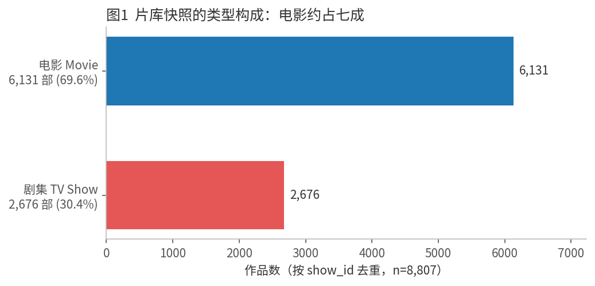
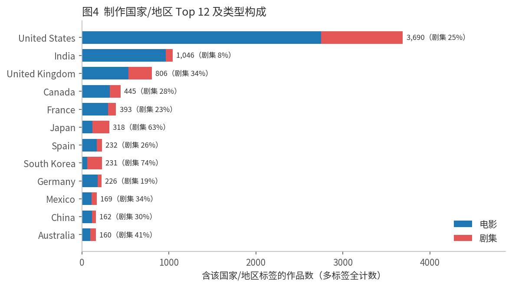
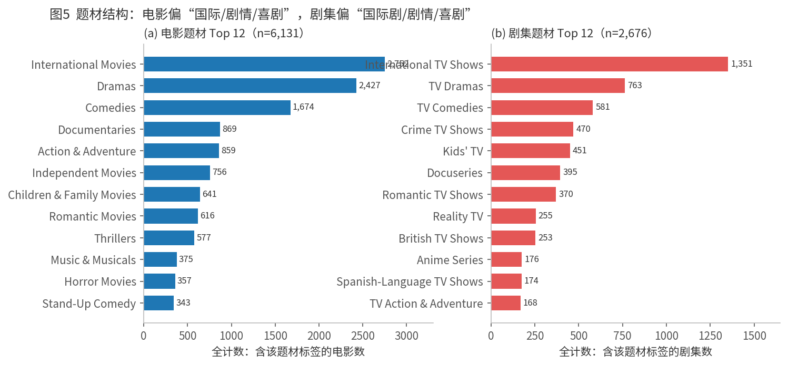
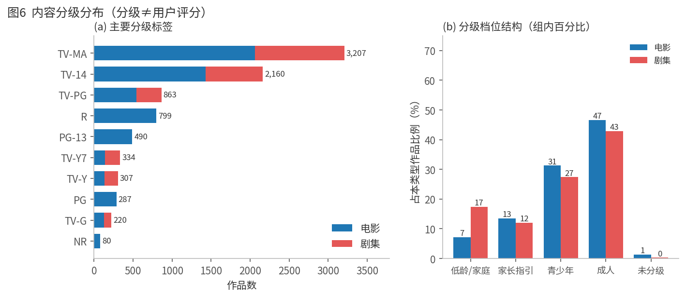
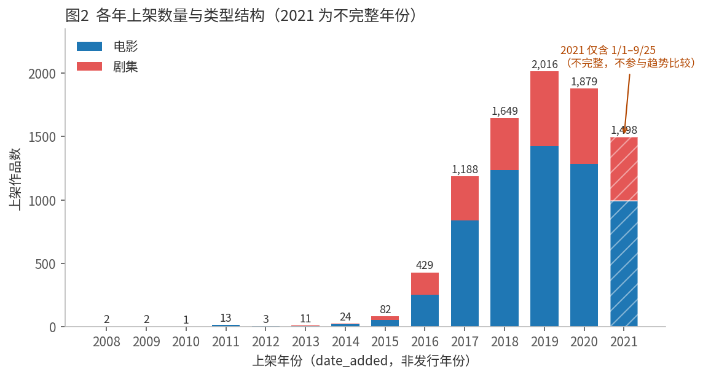
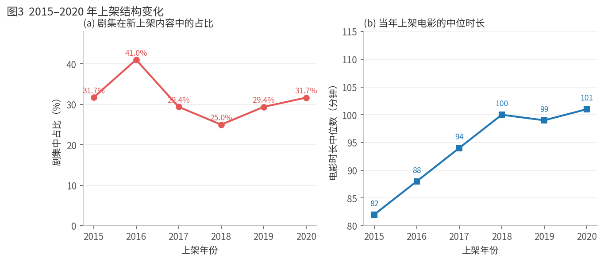
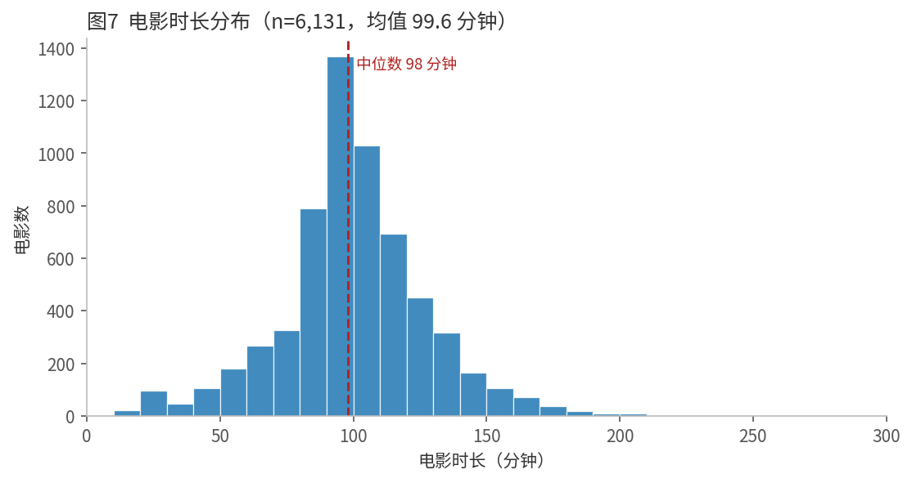
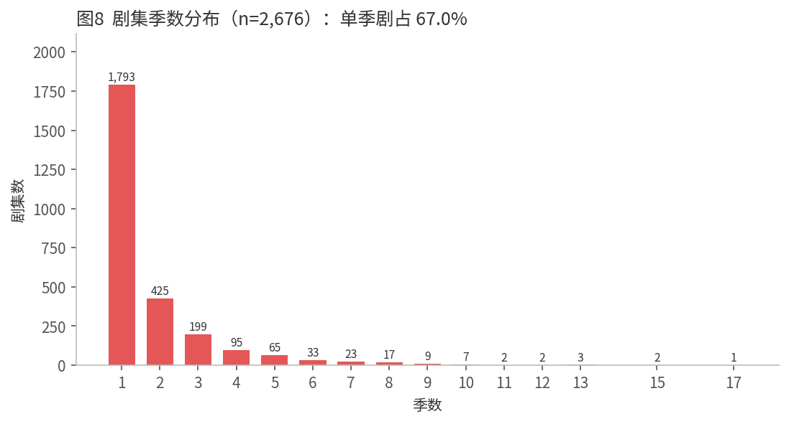

# Netflix 片库快照内容结构分析

**数据来源**：Netflix Movies and TV Shows，shivamb / Kaggle，<https://www.kaggle.com/datasets/shivamb/netflix-shows/data>
**分析对象**：本工作区所附历史文件 `data/netflix_titles.csv`（8,807 行 × 12 列，按 `show_id` 唯一）
**文件内最新有效上架日期**：**2021-09-25**（最早 2008-01-01）

> 本报告分析的是**所附这一份历史快照文件**，不是 Netflix 当前片库，也不是其完整历史。文件内的"上架日期"（`date_added`）与"发行年份"（`release_year`）是两个独立字段，本报告分别使用，未混用。

---

## 一、摘要

1. **结构以电影为主**：8,807 部唯一作品中电影 6,131 部（69.6%）、剧集 2,676 部（30.4%），电影约为剧集的 2.3 倍。
2. **本快照保留的上架记录集中在 2016–2020 年**：这 5 年记录 7,161 部，占本快照全部作品的 81.3%；峰值在 2019 年（2,016 部），2020 年较 2019 年减少 6.8%。这些数字只反映**本文件保留的上架条目**，不等于 Netflix 当年的完整新增量，也不能用于计算净增长。2021 年数据只到 9 月 25 日，**不完整，不参与趋势比较**。
3. **类型结构并非单向变化**：剧集在新上架内容中的占比 2016 年 41.0% → 2018 年 25.0% → 2020 年 31.7%，是先降后升的 U 形；但剧集的**绝对上架量**逐年递增（176 → 595 部）。
4. **国家标签高度集中**：在有国家信息的 7,976 部中，美国占 46.3%、印度占 13.1%（均为多标签全计数份额，合拍片重复计入，两项不能相加当作去重占比；其和 59.4% 只用于示意集中度）。印度、香港的片单以电影为主（剧集占比 8.0%、4.8%），日本、韩国以剧集为主（62.6%、73.6%）。
5. **内容分级偏向成人向**：成人档（TV-MA / R / NC-17）占 45.5%，青少年档 30.1%，低龄/家庭档仅 10.3%。剧集的低龄/家庭比例（17.4%）明显高于电影（7.2%）。**分级是内容分级，不是用户评分。**
6. **电影时长集中在 90–120 分钟**：中位数 98 分钟（P10 65、P90 133），51.3% 落在 90–120 分钟。
7. **剧集以单季为主**：67.0% 只有 1 季，仅 6.1% 达到 5 季及以上；最长 17 季（Grey's Anatomy，快照时点）。

---

## 二、数据质量与清理

### 2.1 字段缺失

| 字段 | 缺失数 | 缺失率 | 处理 |
|---|---|---|---|
| `director` | 2,634 | 29.9% | 保留为缺失，不用于分析 |
| `cast` | 825 | 9.4% | 保留为缺失，不用于分析 |
| `country` | 831 | 9.4% | 单列"国家未知"，不按 0 计入占比 |
| `date_added` | 10 | 0.11% | 不计入任何上架年份统计 |
| `rating` | 7（原始 4 + 错位 3） | 0.08% | 归入"未分级"，不推断 |
| `duration` | 0（修正后） | 0% | 原始 3 个空值由错位的 `rating` 回填 |
| 其他（`show_id`/`type`/`title`/`release_year`/`listed_in`/`description`） | 0 | 0% | — |

### 2.2 已发现的问题与处理

| 问题 | 数量 | 证据 | 处理方式 |
|---|---|---|---|
| 重复 `show_id` | **0** | `show_id` 唯一值 8,807 | 无需处理；作品总数按唯一 ID 计 |
| 重复作品 | 1 组 / 2 行 | `s3372`、`s6530` 均为 "Consequences"（Turkey, 2014, 2019-10-25），除 ID 外全字段一致 | **保留**（ID 不同），在口径中说明书目标题数比作品数少 1 |
| `rating` 与 `duration` 错位 | 3 行 | `s5542`、`s5795`、`s5814` 的 `rating` 值为 "74 min/84 min/66 min"，`duration` 为空 | 值回填到 `duration`，`rating` 置为缺失（不猜测真实分级） |
| `date_added` 前后空格 | 88 行 | 如 `" August 4, 2017"`，直接解析会失败 | 去首尾空白后重新解析，8,797 条全部成功 |
| `title` 尾随空格 | 1 行 | — | 去空格 |
| 上架年份早于发行年份 | 14 行 | 13 部剧集 + 1 部电影，如 BoJack Horseman（2019-10-25 上架，`release_year` 2020） | **保留**：剧集 `release_year` 通常指最新季年份，属口径特征而非脏数据；不做删改 |
| 电影分级用于剧集 | 少量 | 2 部剧集标 `R`（The Hateful Eight: Extended Version、Nobel），7 部标 `NR` | 保留原值，分析时按标签原样统计 |
| 电影时长极值 | 少量 | 最短 3 分钟、最长 312 分钟 | 保留：为真实短片/长片，未做截断 |
| 题材标签跨类型不通用 | 42 个标签 | 20 个仅用于电影、22 个仅用于剧集，**两边无任何交集** | 电影与剧集的题材分别统计，不做直接合并排名 |

### 2.3 多标签情况（全计数口径）

- **国家**：1,315 部作品带 ≥1 个国家标签（占 14.9%），最多 12 个国家；国家标签总数 10,012 个，而含国家信息的作品仅 7,976 部——**标签数大于作品数**，因此占比之和不等于 100%。
- **题材**：6,787 部作品带 ≥1 个题材标签（占 77.1%），平均每部 2.19 个；题材标签总数 19,323 个。
- 清理只写入派生文件 `tables/netflix_titles_clean.csv`（保留原值列并新增解析列），**未修改原始 CSV**。

---

## 三、片库内容结构总览



| 类型 | 作品数 | 占比 | 平均题材标签数 | 有国家信息比例 |
|---|---|---|---|---|
| 电影 Movie | 6,131 | 69.6% | 2.15 | 92.8% |
| 剧集 TV Show | 2,676 | 30.4% | 2.29 | 85.4% |
| 合计 | 8,807 | 100% | 2.19 | 90.6% |

按**发行年份**看，片库偏新：中位发行年份 2017，84.8% 的作品发行于 2010 年及以后，64.2% 发行于 2016 年及以后；1979 年及以前的老片仅 122 部（1.4%）。

| 发行年份区间 | 电影 | 剧集 | 合计 | 剧集占比 |
|---|---|---|---|---|
| ≤1979 | 113 | 9 | 122 | 7.4% |
| 1980–1989 | 122 | 7 | 129 | 5.4% |
| 1990–1999 | 241 | 33 | 274 | 12.0% |
| 2000–2009 | 677 | 133 | 810 | 16.4% |
| 2010–2015 | 1,359 | 457 | 1,816 | 25.2% |
| 2016–2019 | 2,825 | 1,286 | 4,111 | 31.3% |
| 2020–2021 | 794 | 751 | 1,545 | **48.6%** |

发行年份越新，剧集占比越高（2020–2021 年发行的作品中剧集接近一半），说明片库的"新内容"更偏剧集。

---

## 四、制作国家 / 地区差异

> **口径**：按 `country` 逗号拆分后的**全计数**。一部合拍片会同时计入每个国家；分母为"含国家信息的 7,976 部作品"，不是全部 8,807 部。



| 国家/地区 | 电影 | 剧集 | 合计 | 占含国家信息作品 | 剧集占比 |
|---|---|---|---|---|---|
| United States | 2,752 | 938 | 3,690 | 46.3% | 25.4% |
| India | 962 | 84 | 1,046 | 13.1% | 8.0% |
| United Kingdom | 534 | 272 | 806 | 10.1% | 33.7% |
| Canada | 319 | 126 | 445 | 5.6% | 28.3% |
| France | 303 | 90 | 393 | 4.9% | 22.9% |
| Japan | 119 | 199 | 318 | 4.0% | **62.6%** |
| Spain | 171 | 61 | 232 | 2.9% | 26.3% |
| South Korea | 61 | 170 | 231 | 2.9% | **73.6%** |
| Germany | 182 | 44 | 226 | 2.8% | 19.5% |
| Mexico | 111 | 58 | 169 | 2.1% | 34.3% |

要点：

- 共出现 **122 个国家/地区标签**，但头部极集中：美国 46.3% 与印度 13.1% 的多标签份额之和为 59.4%，前 5 国份额之和 80.0%——这些是**全计数份额的加总，不是去重作品占比**，仅用于示意集中度。
- **同一国家内部的类型结构差异很大**：在作品数 ≥100 的国家里，韩国（73.6%）、日本（62.6%）以剧集为主；香港（4.8%）、印度（8.0%）、尼日利亚（8.7%）几乎全是电影。美国虽是最大来源，但剧集占比只有 25.4%，与本快照整体 30.4% 接近。
- 剧集侧来源更分散：电影 Top3 为美国 2,752、印度 962、英国 534；剧集 Top3 为美国 938、英国 272、日本 199（印度不在剧集前三）。
- 9.4% 的作品没有国家信息。缺失原因无法由现有字段确定（可能涉及地区信息未披露、合拍归属不清或填报遗漏等），本报告不做推断；这些作品未进入国家占比的分母，因此国家结构对全体作品只具有指示性。

---

## 五、题材结构

> **口径**：`listed_in` 逗号拆分后的**全计数**，分母分别为电影 6,131 部、剧集 2,676 部；一部作品可计入多个题材，占比之和 >100%。电影与剧集的题材标签体系不通用（无交集），故分列。



| 电影题材 | 电影数 | 占电影 | | 剧集题材 | 剧集数 | 占剧集 |
|---|---|---|---|---|---|---|
| International Movies | 2,752 | 44.9% | | International TV Shows | 1,351 | 50.5% |
| Dramas | 2,427 | 39.6% | | TV Dramas | 763 | 28.5% |
| Comedies | 1,674 | 27.3% | | TV Comedies | 581 | 21.7% |
| Documentaries | 869 | 14.2% | | Crime TV Shows | 470 | 17.6% |
| Action & Adventure | 859 | 14.0% | | Kids' TV | 451 | 16.9% |
| Independent Movies | 756 | 12.3% | | Docuseries | 395 | 14.8% |
| Children & Family Movies | 641 | 10.5% | | Romantic TV Shows | 370 | 13.8% |
| Romantic Movies | 616 | 10.0% | | Reality TV | 255 | 9.5% |

要点：

- 两类内容的共同主轴是**"国际作品 + 剧情 + 喜剧"**：电影侧 International Movies 44.9%、Dramas 39.6%；剧集侧 International TV Shows 50.5%（剧集第一大标签，占比高于电影侧对应标签）。
- 差异在于：电影有更多**独立片（12.3%）、纪录片（14.2%）、儿童家庭片（10.5%）**等细分标签；剧集则在**犯罪（17.6%）、儿童（16.9%）、纪实（14.8%）、真人秀（9.5%）、爱情（13.8%）**上更突出，题材分布更均匀。
- 42 个题材标签中有 "Movies"（57 部）和 "TV Shows"（16 部）这类兜底标签，占比极小，未单独归类。
- 题材是 Netflix 的商品化分类（含 "British TV Shows"、"Korean TV Shows"、"Spanish-Language TV Shows" 等按国家/语言划分的标签），**不代表影片的客观类型学分类**。

---

## 六、内容分级（不是用户评分）

> **口径**：`rating` 是**内容分级/家长指引标签**（TV-MA、PG-13 等），**不是**用户打分、星级或影评分数；`NR`/`UR` 为"未分级"，缺失也归入未分级。本数据不含任何用户评分字段。



| 分级档（映射） | 电影 | 剧集 | 合计 | 占全部 | 电影组内 | 剧集组内 |
|---|---|---|---|---|---|---|
| 成人（TV-MA / R / NC-17） | 2,862 | 1,147 | 4,009 | 45.5% | 46.7% | 42.9% |
| 青少年（TV-14 / PG-13） | 1,917 | 733 | 2,650 | 30.1% | 31.3% | 27.4% |
| 家长指引（PG / TV-PG） | 827 | 323 | 1,150 | 13.1% | 13.5% | 12.1% |
| 低龄/家庭（G / TV-G / TV-Y / TV-Y7 / TV-Y7-FV） | 442 | 466 | 908 | 10.3% | 7.2% | **17.4%** |
| 未分级（NR / UR / 缺失） | 83 | 7 | 90 | 1.0% | 1.4% | 0.3% |

单标签层面：TV-MA 3,207（36.4%）、TV-14 2,160（24.5%）、TV-PG 863（9.8%）、R 799（9.1%）、PG-13 490（5.6%）、TV-Y7 334、TV-Y 307、PG 287、TV-G 220、NR 80、G 41。

要点：

- 本快照整体以**成人向**为主（45.5%），加上青少年档共 75.6%。
- **剧集的低龄/家庭比例是电影的 2.4 倍**（17.4% vs 7.2%）：动画与儿童剧是剧集侧的重要组成（Kids' TV 451 部）。
- **分级标签与内容类型基本绑定**：PG-13 / PG / R / G / NC-17 只出现在电影，TV-* 只出现在剧集；仅 2 部剧集被标为 R、7 部剧集为 NR（见 2.2 的标注不一致说明）。
- 分级不能解释为质量或受欢迎程度；它只说明面向的观众年龄层。

---

## 七、2016–2020 年上架作品的数量与类型结构

> **口径**：按 **`date_added` 的上架年份**统计，不是 `release_year` 发行年份；统计对象是**本快照保留的上架记录**，不代表历史完整新增量或净增长。2021 年仅覆盖 1 月 1 日–9 月 25 日（9 个月、1,498 部），图中以斜纹标出，**不参与趋势判断**。



| 上架年份 | 电影 | 剧集 | 合计 | 剧集占比 | 合计同比 |
|---|---|---|---|---|---|
| 2015 | 56 | 26 | 82 | 31.7% | — |
| 2016 | 253 | 176 | 429 | **41.0%** | +423.2% |
| 2017 | 839 | 349 | 1,188 | 29.4% | +176.9% |
| 2018 | 1,237 | 412 | 1,649 | **25.0%** | +38.8% |
| 2019 | 1,424 | 592 | 2,016 | 29.4% | +22.3% |
| 2020 | 1,284 | 595 | 1,879 | 31.7% | −6.8% |
| 2021（不完整） | 993 | 505 | 1,498 | 33.7% | 不与完整年比较 |



观察：

1. **总量**：快照内记录的上架量从 429 增至 1,879（+338%），2019 年达峰 2,016 部，2020 年回落 6.8%（仅为文件内条目数，不代表完整新增或净增长）。2015 年基数极小（82 部），因此 2016 年的高增速主要反映基数效应。
2. **电影绝对量先增后减**：253 → 1,424（2019 峰值）→ 1,284；**剧集绝对量持续增长**：176 → 595（+238%），2020 年剧集数量首次超过 2019 年。
3. **剧集占比是 U 形而非单调上升**：2016 年 41.0%（当年剧集 176 部，且首题材为 International TV Shows）→ 2018 年降至 25.0% → 2020 年回升到 31.7%。2016 年的高占比来自小基数下的剧集集中上架，不宜解读为"剧集占比逐年提升"。
4. **电影时长随上架年份略微变长**：当年上架电影的中位时长 88（2016）→ 94（2017）→ 100（2018）→ 99（2019）→ 101（2020）分钟；剧集中位季数始终为 1 季。
5. 2016–2020 年的 7,161 部中电影 5,037 部（70.3%）、剧集 2,124 部（29.7%），与本快照整体结构（69.6% / 30.4%）接近——**总量增长没有改变整体电影主导的结构**。
6. 对照**发行年份**口径：2016–2020 年"发行"的作品为 5,064 部，与"上架"的 7,161 部相差 2,097 部，差额主要来自往年发行、近年补上架的老片（15.2% 的作品在上映 10 年及以上才上架，中位上架滞后 1 年，55.0% 在发行后 1 年内上架）。两个口径不可互换。

---

## 八、电影时长分布



| 指标 | 数值 |
|---|---|
| 有效样本（`duration` = "N min"） | 6,131 部（无缺失） |
| 均值 ± 标准差 | 99.6 ± 28.3 分钟 |
| 中位数 | 98 分钟 |
| P10 / P25 / P75 / P90 | 65 / 87 / 114 / 133 分钟 |
| 最小 / 最大 | 3 / 312 分钟 |
| <60 分钟 | 7.5% |
| 90–120 分钟 | 51.3% |
| >120 分钟 | 18.6% |

- 分布单峰、右偏：一半电影在 87–114 分钟之间，超过 2 小时的仅 18.6%。
- 60 分钟以下的 458 部（7.5%）多为单口喜剧特辑、纪录片与短片。
- 时长与题材相关：纪录片中位 86 分钟、儿童家庭片中位 87 分钟，明显短于剧情片 109 分钟、国际片中位 107 分钟。

| 题材（电影） | 电影数 | 中位时长 | 均值 |
|---|---|---|---|
| International Movies | 2,752 | 107 | 110.3 |
| Dramas | 2,427 | 109 | 113.1 |
| Comedies | 1,674 | 101 | 103.9 |
| Documentaries | 869 | 86 | 81.6 |
| Action & Adventure | 859 | 108 | 113.5 |
| Independent Movies | 756 | 98 | 101.1 |
| Children & Family Movies | 641 | 87 | 79.9 |
| Romantic Movies | 616 | 107 | 110.6 |

---

## 九、剧集季数分布



| 指标 | 数值 |
|---|---|
| 有效样本（`duration` = "N Season(s)"） | 2,676 部（无缺失） |
| 均值 / 中位数 | 1.76 / 1 季 |
| 1 季 | 1,793 部（67.0%） |
| 2 季 | 425 部（15.9%） |
| ≥3 季 | 458 部（17.1%） |
| ≥5 季 | 164 部（6.1%） |
| ≥10 季 | 17 部（0.6%） |
| 最长 | 17 季（Grey's Anatomy，快照时点） |

- 剧集以**短生命周期**为主：三分之二只有 1 季，2 季以内合计 82.9%。
- 长尾很薄：5 季以上仅 6.1%，10 季以上 17 部（Grey's Anatomy 17、Supernatural / NCIS 15、Heartland / COMEDIANS of the world 13 等）。
- 季数是**快照时点**的累计季数，不代表已完结，也不代表续订前景。

---

## 十、主要发现

1. **这是一份"电影主导 + 近年上架为主"的快照**：电影 69.6%，本快照保留的上架记录中 81.3% 落在 2016–2020 年，中位发行年份 2017。
2. **快照内记录的上架量在 2016–2019 年快速扩张，2020 年回落**：429 → 2,016（2019 峰值）→ 1,879（2020，−6.8%）。这只是本文件保留的条目数，不代表完整新增量，也不能据此推断采购策略或片库净增长；2020 的回落与 2021 的不完整都需谨慎解读。
3. **类型结构是 U 形，不是线性替代**：剧集占比 41.0%（2016）→ 25.0%（2018）→ 31.7%（2020），但剧集绝对量逐年增长（176 → 595，+238%）。
4. **地域结构"一超一强 + 长尾"**：美国 46.3%、印度 13.1%（多标签全计数份额，不能相加当作去重占比）；122 个国家/地区标签里多数只出现个位数。同一国家的类型结构差异显著（韩国/日本偏剧集，印度/香港偏电影）。
5. **题材是"国际 + 剧情 + 喜剧"三件套**：电影侧 International Movies 44.9%、Dramas 39.6%；剧集侧 International TV Shows 50.5%、TV Dramas 28.5%。剧集在犯罪、儿童、纪实、真人秀上更分散。
6. **分级偏成人向，剧集更"合家欢"**：成人档 45.5%，但低龄/家庭档中剧集占 17.4%、电影仅 7.2%。分级不等于评分。
7. **形态稳定**：电影时长中位 98 分钟、51.3% 落在 90–120 分钟；剧集 67.0% 为单季。两类内容的"标准件"特征明显，且 2016–2020 年上架电影的中位时长仅有小幅上升（88 → 101 分钟）。

---

## 十一、统计口径汇总

| 项目 | 口径 |
|---|---|
| 作品总数 | 按唯一 `show_id` 去重 = 8,807；标题去重后为 8,806（"Consequences" 重复 1 组） |
| 电影 / 剧集 | 按 `type` 字段（Movie / TV Show），互斥，无缺失 |
| 上架年份 | `date_added` 解析后的年份；10 条缺失不计入 |
| 发行年份 | `release_year` 字段，1925–2021；与上架年份分开统计 |
| 2021 年 | 仅 1/1–9/25，**不完整**，图表中以斜纹/灰色标注，不进入增速与趋势结论 |
| 国家 | `country` 按逗号拆分，**全计数**（合拍片重复计入）；分母为含国家信息的 7,976 部 |
| 题材 | `listed_in` 按逗号拆分，**全计数**；电影、剧集分别以 6,131 / 2,676 为分母 |
| 内容分级 | `rating` 原标签；5 档映射见第六节；`NR`/`UR`/缺失 = 未分级；**不是用户评分** |
| 电影时长 | 仅 `type = Movie`，`duration` 解析为分钟（"N min"），n = 6,131 |
| 剧集季数 | 仅 `type = TV Show`，`duration` 解析为季数（"N Season(s)"），n = 2,676 |
| 占比 | 未特别说明时为占全部 8,807 部；国家占比为占含国家信息的 7,976 部；题材占比为占本类型作品数 |

---

## 十二、局限与不可推断项

1. **这是历史快照，不是完整片库历史**。文件中只有仍然存在（或当时被记录）的作品，**没有下架记录**，因此无法计算净增长、留存率或片库总规模的时间序列；2016–2020 的"上架数量"只是本文件内被记录的上架条目数。
2. **不能推断播放热度、观看时长、收入、订阅或版权成本**——数据中没有任何播放量、评分、预算、地区授权字段。`rating` 是内容分级，不能当用户评分使用。
3. **2021 年不完整**（截至 9 月 25 日），任何"2021 下降"的结论都不成立。
4. **上架日期有 10 条缺失**，国家信息有 831 条缺失（9.4%）。缺失原因无法由现有字段确定，不能假定为随机缺失，因此国家结构对全体作品只具有指示性。
5. **多标签全计数会放大头部**：一部合拍片计入多个国家，一部多题材作品计入多个题材，占比之和 >100%，不能按"市场份额"解读。
6. **题材标签是平台商品化分类**，含国家级（British/Korean/Spanish-Language）与兜底标签（Movies / TV Shows），不宜作为严格的类型学结论。
7. **发行年份对剧集可能指最新季年份**，因此出现 14 条"上架早于发行"的记录；这部分未修正，仅作说明。
8. **无外部对照**：本报告不做与 Netflix 官方片库或其他数据集的比对，所有结论限于本文件。

---

## 十三、复跑与交付物

```bash
cd <工作区>
python3 analysis.py        # 读取 data/netflix_titles.csv，生成 figures/ tables/ metrics.json
```

脚本使用内置 Python 3.12 + pandas / numpy / matplotlib，无网络依赖、不安装任何包；路径均为相对工作区的相对路径；**只读取原 CSV，不修改**。

| 文件 | 内容 |
|---|---|
| `report.md` | 本报告 |
| `analysis.py` | 完整可复跑分析脚本（清洗 → 核查 → 统计 → 8 张图 → 汇总表 → metrics.json） |
| `metrics.json` | 报告中引用的全部指标原始数值 |
| `figures/fig1_type_overview.png` … `fig8_tv_seasons.png` | 静态图表（8 张） |
| `tables/netflix_titles_clean.csv` | 派生清洗数据（含解析后的日期、分钟、季数、标签数） |
| `tables/qc_missing.csv` | 字段缺失核查 |
| `tables/overview_type.csv` | 类型构成 |
| `tables/year_added_by_type.csv` | 上架年份 × 类型 |
| `tables/release_year_bucket.csv` | 发行年份区间 × 类型 |
| `tables/country_counts.csv` | 122 个国家/地区全计数（电影/剧集拆分） |
| `tables/genre_counts.csv` | 42 个题材标签全计数（电影/剧集拆分） |
| `tables/rating_counts.csv`、`rating_tier.csv` | 分级标签与分级档统计 |
| `tables/movie_duration_stats.csv`、`movie_duration_by_add_year.csv`、`movie_duration_by_genre.csv` | 电影时长统计 |
| `tables/tv_seasons_counts.csv` | 剧集季数分布 |
| `tables/year_2016_2020_profile.csv` | 2016–2020 逐年画像（剧集占比、首位题材、中位时长/季数） |
